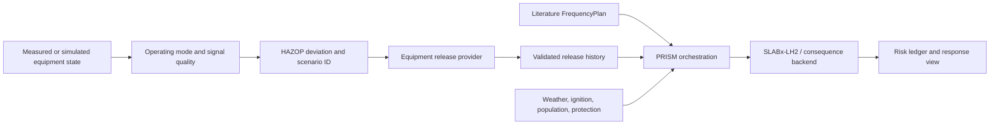

# PRISM

**Process Risk Integration and Scenario Modeling**

PRISM is an auditable research framework for connecting process and equipment state, HAZOP deviations, literature-based initiating frequencies, equipment release histories, hydrogen dispersion, and conditional facility-risk views.

> **Research software notice:** PRISM is designed for diagnostic and research workflows. A completed calculation chain does not by itself constitute regulatory certification, independent physical validation, or a complete facility QRA.

## Quick start

Install the published Python package:

```powershell
python -m pip install "prism-risk[test]==0.6.3"
prism --describe-modes
```

Or clone the public repository and run the test suite:

```powershell
git clone https://github.com/lyullee/prism.git
cd prism\lh2-tno
python -m pip install -e ".[test]"
python -m pytest -q
```

The package name is `prism-risk`; the command-line entry point is `prism`. Python 3.12 or newer is recommended.

## What the framework connects



The current-state path supports low-latency monitoring when a validated release history is available. The predicted-state path accepts a simulation state and records `input_origin="model_prediction"`. Operating mode, HAZOP selection, release history, frequency evidence, consequence output, uncertainty, latency, and response status remain separately traceable.

## Supported scope

PRISM provides the orchestration and audit boundary for generic outdoor LH2 facilities such as tanks, transfer lines, valves, pumps, vaporizers, and vents. External process and consequence models remain independent providers. PRISM does not silently infer a leak size from pressure and temperature, convert normal flow into an accident history, learn annual frequency from alarm counts, or extend a short provider history to an assumed full release.

## Documentation

The detailed package documentation is in [`lh2-tno/README.md`](lh2-tno/README.md):

- [English user manual](lh2-tno/docs/PRISM_USER_MANUAL_en.md)
- [English digital-twin interface guide](lh2-tno/docs/PRISM_INTERFACE_INTEGRATION_GUIDE_en.md)
- [English v0.6.3 distribution record](lh2-tno/docs/PRISM_v063_PyPI_DOI_DISTRIBUTION_RECORD_20261015.md)
- [Korean package README](lh2-tno/README_ko.md)
- [Korean source README](README_ko.md)

The interface guide defines the state-frame, HAZOP, provider release, frequency, result, and acceptance-test contracts needed to connect an equipment digital twin.

## Release links

- [GitHub Release v0.6.3](https://github.com/lyullee/prism/releases/tag/v0.6.3)
- [PyPI: prism-risk 0.6.3](https://pypi.org/project/prism-risk/0.6.3/)
- [PyPI workflow](https://github.com/lyullee/prism/actions/runs/38689574587)
- [PRISM concept DOI](https://doi.org/10.5281/zenodo.23241358)
- [Reserved v0.6.3 Zenodo DOI](https://doi.org/10.5281/zenodo.23387052) — resolves after final publication

## Reproducibility

For every result, preserve the exact state frame, HAZOP row, provider release digest, `FrequencyPlan` revision, weather and protection inputs, package version or commit, and result ledger. Compare reruns by event ID, case ID, risk atom ID, and provider digest rather than by a rounded total alone.

## License

PRISM is released under the [MIT License](LICENSE). External process models, consequence backends, datasets, and source material retain their own licenses and citation requirements.
