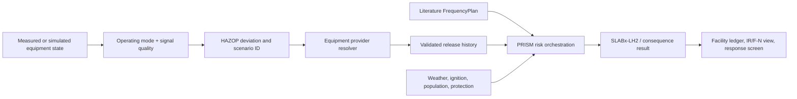

# PRISM

**Process Risk Integration and Scenario Modeling**

PRISM is a Python research framework for connecting process and equipment state, HAZOP deviations, literature-based initiating frequencies, equipment release histories, hydrogen dispersion, and conditional facility risk views.

[](https://pypi.org/project/prism-risk/)
[](https://www.python.org/)
[](LICENSE)

## Start here

Install the latest published package:

```powershell
python -m pip install "prism-risk[test]==0.6.3"
prism --describe-modes
```

From a source checkout:

```powershell
cd lh2-tno
python -m pip install -e ".[test]"
python scripts/verify_latest_ijhe_audit.py --output results/20261115/latest_ijhe_audit_verification.json
python -m pytest -q
```

Try the equipment boundary check:

```powershell
lh2-tno --equipment-manifest examples/equipment_manifest.json --output build/manifest_check.json
```

The current checkout validation result is **1,419 passed, 1 warning**. The warning is a Python 3.14 deprecation warning from `pytest-asyncio`; it is reported separately from a failing contract.

The latest IJHE readiness record is intentionally fail-closed: it reports the
diagnostic chain and its conditional IR/F-N view, while withholding a formal
facility-QRA claim until every release boundary has qualified provider evidence
and independent validation. See the [English readiness audit](docs/PRISM_IJHE_latest_audit_20261115_en.md)
for the current 44-case counts and open evidence requests.

## What PRISM is for

PRISM helps an operator or researcher answer:

- Which HAZOP deviation is active for this equipment and operating mode?
- Which accident scenario and release port does that deviation select?
- Does a qualified equipment provider supply a time-resolved release history?
- Which literature frequency is bound to the event?
- What does SLABx-LH2 or another declared consequence backend calculate?
- What evidence, uncertainty, latency, and response action should be shown?

The framework supports generic outdoor LH2 facilities, including tanks, transfer lines, valves, pumps, vaporizers, and vents. It is designed to connect to an existing process digital twin. The equipment model remains the owner of thermodynamics, inventory, isolation, and accident release history.

For inspection-centre or historian signals, PRISM records the unit carried by
the source column separately from a procedure or setpoint comparison unit. See
the [unit-role guide](docs/PRISM_source_vs_comparison_unit_roles_20261017.md).
This prevents an MPa source column from being silently relabeled as bar while
keeping the state-promotion gate closed until pressure basis and data quality
are reviewed.

For a compact multi-equipment demonstration, see the [native pump + valve facility campaign](docs/PRISM_native_multi_equipment_facility_campaign_20261016.md). It binds a liquid pump packet and a gas valve packet to one facility ledger, retains release duration and mass-balance evidence, and keeps every unmatched frequency opening explicitly `UNCOMPUTED`.

When a qualified equipment model returns a reviewed termination packet, the
[release-boundary response handoff](docs/PRISM_release_boundary_response_handoff_20261017.md)
connects response intake, provider termination evidence, and case-level packet
matching without silently promoting the result to facility QRA.

For accidental gas, liquid, and two-phase releases, the optional [dynamic state closure contract](docs/PRISM_dynamic_liquid_state_closure_contract_en.md)
shows how an equipment twin can prove that changing pressure and inventory
were fed back into the release history. Without that explicit evidence, PRISM
keeps the source `EXECUTED_OPERATOR_LIMITED` even when the downstream
consequence chain runs successfully. Campaign and facility ledgers retain the
closure status per case and per equipment component.

The companion [`lh2dt_models`](https://github.com/lyullee/lh2dt_models)
package now emits the closure object from its finite-volume
`DynamicHEMPipe`, `LayeredTank`, and `DynamicVaporizer` accident exporters
(commit [`16f7a4b`](https://github.com/lyullee/lh2dt_models/commit/16f7a4b)).
Those exporters hash the provider state history and report inventory and
pressure residuals. Fixed-source valves, pumps, and vent stacks deliberately
remain operator-limited until an upstream dynamic inventory owner is attached.
Current native diagnostic handoffs for a dynamic pipe, a layered storage tank,
and a dynamic vaporizer are saved under
`results/20261115/native_*_closure_check_current`; all three pass the PRISM
source-dynamics gate with reviewed isolation termination while retaining their
synthetic and unvalidated status.
The seven-equipment recheck in
`results/20261115/native_external_multi_equipment_recheck_current/manifest.json`
shows the same handoff across the dynamic pipe, layered tank, vaporizer, and
reliquefier. Fixed-source valve, pump, and vent-stack rows remain explicitly
diagnostic or operator-limited.
The follow-on chain replay is recorded in
`results/20261115/native_external_multi_equipment_chain_recheck_current/manifest.json`.
It consumes the same seven resolved-release packets, runs six SLABx-LH2 paths
and one compressible-plane path, and carries the provider dynamic-state
closure object for the tank, pipe, vaporizer, and reliquefier rows. The replay
is end-to-end diagnostic evidence only: no initiating frequency, provider
qualification, independent physical validation, or facility IR/F-N claim is
created.

The clean-source seven-equipment snapshot used for the current status pointer
is the compact record
[`examples/native_external_multi_equipment_recheck_current_20261017.json`](examples/native_external_multi_equipment_recheck_current_20261017.json).
Run `scripts/verify_latest_ijhe_audit.py` to bind that record to
`CURRENT_STATUS.json` and check its source digest, equipment identities,
state-snapshot echoes, dynamic closures, and fail-closed promotion flags. This
verification is diagnostic bookkeeping; it does not qualify provider packets
or open the facility-QRA gate.

The current facility-level diagnostic replay is stored under
`results/20261115/native_external_facility_campaign_current/` with its
seven input packet directories in
`results/20261115/native_external_facility_packets_current/`. It matches 7 of
24 catalogue events, keeps 17 opening bins explicitly `UNCOMPUTED`, and
produces a conditional IR/F-N view across three literature-frequency
scenarios. Facility-wide QRA promotion remains closed until the missing
provider, release-boundary, physical-validation and scope evidence is supplied.

The smaller current header-bound replay is documented in the
[current header-bound bridge record](docs/PRISM_header_bound_current_bridge_20261017.md).
Its summary exposes frequency-uncertainty coverage per selected event: the
current diagnostic has one explicit p05/published/p95 binding and two branches
whose bounds are still missing. PRISM keeps those two gaps visible and does not
impute an interval or infer a frequency from monitoring signals.

The current 24-event native full-scope replay is stored under
`results/20261115/native_external_facility_full_scope_campaign_current/`. It
retains 24 exact packet matches, 96 conditional risk atoms, and 11
operator-limited case assessments. The companion
`provider_qualification_requests.json` is the provider handoff worksheet. The
readiness audit found 13 exact diagnostic packet matches, but the request
builder now checks the packet's family-specific termination ledger before
calling a request qualification-only. The current worksheet therefore has 7
qualification-only requests and 19 requests that still need release closure
plus qualification evidence. Generate the fillable sidecar manifest with:

```powershell
python scripts/build_provider_sidecar_manifest_template.py `
  --catalogue results/20261115/native_external_facility_full_scope_campaign_current/provider_qualification_requests.json `
  --output results/20261115/native_external_facility_full_scope_campaign_current/provider_qualification_sidecar_manifest_template.json
```

The resulting 26 release identities preserve packet digests and indexes. They
remain `TEMPLATE_ONLY`; replacing a placeholder with a reviewed
`prism.provider_qualification_evidence.v1` sidecar is required before a
provider result can be qualified. This workflow never infers frequency from
signals and never enables facility QRA by itself.

The clean-source replay of the same 24-event scope is documented in the
[clean-source full-scope replay record](docs/PRISM_native_clean_full_scope_replay_20261017.md).
It uses `lh2dt_models@16f7a4b`, matches and executes all 24 packet identities,
and records a 416.8 s offline diagnostic runtime. Twenty-two cases remain
operator-limited/withheld, so the result is a traceable conditional diagnostic
view rather than a facility-QRA claim. The exact HAZOP mode binding is
generated from the reviewed frequency plan by
`scripts/build_hazop_event_mode_binding_from_frequency_plan.py`; missing mode
or scenario fields fail closed.

The same record now includes a clean-source isolation replay. The corrected
valve adapter reaches the declared observation horizon after splitting a step
at the isolation command, so all five transfer-valve opening bins prove the
external provider's zero-opening and zero-flow diagnostic condition. The
replay executed 24/24 cases with 0 uncomputed, 0 failed, and 96 diagnostic risk
atoms in about 388.3 s offline. This is a provider termination check for
synthetic inputs; it does not establish field isolation reliability, provider
qualification, physical validation, facility IR/F-N, or facility QRA.
The companion `facility_risk_summary.json` retains the connected conditional
IR/F-N result, three literature-frequency scenarios, explicit weather,
population, release-termination and ignition branch accounting, and the
component ranking. For the recorded synthetic condition, the worker receptor
diagnostic annual IR is `3.37e-6`; the value remains conditional and does not
open the facility-QRA gate.
The summary also separates execution boundaries: `fresh_physics_executed=false`
means the assessment merge did not rerun physics, while
`source_campaign_physics.executed=true` and
`source_campaign_physics.fresh_physics_cases=24` record the upstream campaign
solves that supplied the saved atoms.

To apply the audit gate to a saved facility assessment without rerunning
physics, use:

```powershell
python scripts/reconcile_native_provider_qualification_assessment.py `
  --assessment results/20261115/native_external_facility_full_scope_campaign_current/facility_assessment.json `
  --audit results/20261115/native_external_facility_full_scope_campaign_current/provider_qualification_audit.json `
  --validation-evidence-matrix results/20261115/native_full_scope_union_assessment_vertical_inventory_handoff_port_bound_isolation_current/validation_evidence_matrix.json `
  --output results/20261115/native_external_facility_full_scope_campaign_current/facility_assessment_provider_qualification_current.json
```

The derived assessment preserves the conditional IR/F-N view while exposing
two independent fail-closed gates: provider qualification and physical
validation. The current matrix is `RESTRICTED_EVIDENCE_MATRIX` with decision
`FACILITY_QRA_WITHHELD`, so the assessment remains `PARTIAL_FACILITY_SCOPE`
and keeps qualified facility QRA disabled. A component replay or a passing
metadata check cannot open this gate.

For a single machine-readable decision across the assessment, provider audit,
and validation matrix, build the facility gate summary:

```powershell
python scripts/build_facility_qra_gate_summary.py `
  --assessment results/20261115/native_external_facility_full_scope_campaign_current/facility_assessment_provider_qualification_current.json `
  --provider-audit results/20261115/native_external_facility_full_scope_campaign_current/provider_qualification_audit.json `
  --validation-matrix results/20261115/native_full_scope_union_assessment_vertical_inventory_handoff_port_bound_isolation_current/validation_evidence_matrix.json `
  --output results/20261115/native_external_facility_full_scope_campaign_current/facility_qra_gate_summary.json
```

The six-gate result is documented in
[`PRISM_facility_qra_gate_summary_20261115_en.md`](docs/PRISM_facility_qra_gate_summary_20261115_en.md).
It currently reports `FACILITY_QRA_WITHHELD`; the diagnostic IR/F-N view remains
visible, and missing evidence is never assigned zero risk.

To check that these status counts remain consistent after campaign merging,
run the independent cross-ledger audit. Supply every campaign used in the
facility merge plus the merged facility ledger:

```powershell
python scripts/audit_dynamic_state_closure_ledger.py `
  --campaign results/campaign_tank.json `
  --campaign results/campaign_transfer_line.json `
  --facility results/facility_ledger.json `
  --output results/dynamic_state_closure_ledger_audit.json
```

The audit recomputes counts from explicit case identities and reports
`PASS`/`BLOCKED` under schema
`prism.dynamic_state_closure_ledger_audit.v1`. A passing accounting audit is
diagnostic evidence only; it does not qualify provider physics or facility
IR/F-N.

Attach the resulting JSON to `scripts/build_ijhe_completion_audit.py` with
`--dynamic-state-closure-ledger-audit` when producing an IJHE readiness record.
The added check remains diagnostic and fail-closed.

The CLI also accepts a facility-assessment file when it contains an explicit
`facility_risk_ledger` object, so saved assessment artifacts can be audited
without manual extraction.

For an older saved result that lacks the new status fields, first make the
absence explicit in a derived copy:

```powershell
python scripts/annotate_dynamic_state_closure_ledger.py `
  --input results/20261115/native_full_scope_union_assessment_vertical_inventory_handoff_port_bound_isolation_current/facility_assessment.json `
  --output .tmp_facility_assessment_dynamic_state.json
```

The annotator writes `NOT_DECLARED` or `NOT_EVALUATED` only. It never creates
`READY` from a mass balance or process value. The resulting accounting audit
can therefore pass while provider qualification and facility QRA remain
withheld.

The larger seven-equipment diagnostic is documented in the [native external facility frequency campaign](docs/PRISM_native_external_facility_frequency_campaign_20261017.md). It adds a tank, transfer line, pump, vaporizer, reliquefier and pressure-relief packet to the same frequency ledger; emergency relief is matched by its dedicated relief event rather than by a leak opening.

The same replay accepts the reviewed HAZOP event-mode binding as an optional
input (`--hazop-event-mode-binding`). On an exact event/component/release-mode
match it carries the field operating mode (`receiving`, `supply`, or `standby`)
and `hazop_scenario_id` into the event route, consequence request, case, and
risk atom. Missing rows stay unbound; PRISM never guesses a mode from pressure,
equipment type, or leak size. The current seven-packet record matched all 24
catalogue event labels, executed seven provider paths, and kept the remaining
17 opening bins `UNCOMPUTED`.

## What PRISM does not infer

PRISM does not infer leak size from pressure and temperature alone, convert normal flow into an accident history, learn an annual accident frequency from alarm counts, extend the last provider interval, or silently replace a missing provider with a similar case. These restrictions keep the risk result auditable.

## The system in one picture



There are two quantitative paths:

1. **Current-state path**: uses measured monitoring state and a cached or already-computed provider release for low-latency response.
2. **Predicted-state path**: uses a simulation state, reruns the provider/consequence chain when a declared risk condition is reached, and preserves `input_origin="model_prediction"`.

## Operating modes and HAZOP

Operating mode is part of the input, such as `receiving`, `supply`, or `standby`. The HAZOP table compares the state value with the row threshold and returns a stable `hazop_scenario_id`.

```json
{
  "id": "TK01-receiving-high-pressure",
  "component_id": "storage-tank-01",
  "operating_modes": ["receiving"],
  "variable_tag": "tank_pressure",
  "quantity": "pressure",
  "trigger": "at_or_above",
  "threshold_high_si": 600000.0,
  "scenario_family": "vessel_hole",
  "release_mode": "hole",
  "safeguards": ["PSV", "ESD"]
}
```

The scenario ID is preserved in the event, case, risk atom, and result ledger. HAZOP selection is qualitative; it does not create an annual frequency.

For a live facility batch, `FacilityRealtimeConsequenceMonitor.update_from_runtime_frames_with_hazop(...)`
combines the two boundaries in one explicit call. It requires exactly one state
frame per declared component, reads `operating_mode` from each frame, evaluates
the bound HAZOP table, dispatches each selected scenario to its matching
equipment release resolver, and then sends the validated release through the
existing realtime monitor and SLABx-LH2 consequence path. A missing or extra
frame is rejected before a provider is called. The returned
`realtime_hazop_bridge` records the selected scenario count and wall time, while
annual facility IR/F-N and frequency learning remain explicitly unavailable.

```python
result = facility_monitor.update_from_runtime_frames_with_hazop(
    hazop_table,
    runtime_frames_by_component,
    now_s=clock_s,
    release_resolvers={
        (component_id, scenario_id): provider_resolver,
    },
)
```

This is the recommended current-state control-room path: monitoring data and
operating mode enter together, HAZOP chooses the qualitative scenario, and the
provider owns release geometry, isolation, duration, and inventory depletion.
The result is a diagnostic current-weather view until the reviewed annual
campaign, provider qualification, and independent validation gates are closed.

The current and predicted paths can be called together with
`run_hazop_integrated_risk(...)`. Measured frames use the same HAZOP table and
equipment provider bindings as the live monitor. Predicted frames must declare
`origin="model_prediction"` and `forecast_time_s`; they re-enter the same
HAZOP selector and provider/SLABx-LH2 consequence gate when a predicted state
reaches a deviation. The predicted scan reports the same facility-level fields
as the live path, but keeps them explicitly withheld until a caller supplies a
reviewed facility aggregator, population ledger, branch weights, and annual
conditions. It never treats a prediction as an observed failure or learns a
frequency from it.

```python
from lh2_tno.integrated_risk import run_hazop_integrated_risk

result = run_hazop_integrated_risk(
    hazop_table,
    current_frames=measured_frames,
    forecast_frames=predicted_frames,
    forecast_tables_by_component=tables_by_component,
    component_bindings=component_bindings,
    release_resolvers=release_resolvers,
    population_binding=population_binding,
    now_s=clock_s,
)
```

Both results carry explicit `facility_annual_ir_available` and
`facility_fn_available` flags. The current path may expose a conditional
current-weather expected-death contribution when the population ledger and
frequency bindings are complete. The forecast path returns
`WITHHELD_FORECAST_FACILITY_AGGREGATOR_REQUIRED` until its future-state
facility aggregation is supplied through `forecast_facility_campaign_evaluator`.
This makes a control-room response screen possible without presenting a
partial forecast as a completed facility QRA.

When a future-state evaluator has already produced explicit facility campaign
records, use the strict trigger-to-ledger adapter described in
[`PRISM_forecast_facility_campaign_handoff_en.md`](docs/PRISM_forecast_facility_campaign_handoff_en.md).
It binds each `component_id|scenario_id|forecast_time_s` trigger to one reviewed
campaign, checks the operating mode and facility identity, and merges the
records without inferring frequencies or replacing missing cases with zero.
The same adapter can be requested in `run_hazop_integrated_risk(...)` with
`forecast_campaign_bindings=...`.

### Importing process-model forecast workbooks

Process-model exports can be converted into the same forecast frames with
[`PRISM_process_forecast_adapter_en.md`](docs/PRISM_process_forecast_adapter_en.md).
The adapter requires an explicit column-to-unit mapping and an explicit
operating mode; it records the workbook digest and marks the rows as
`model_prediction`. For example:

```powershell
python scripts/build_process_forecast_frames.py `
  --source "C:\Users\lyul\Desktop\DocuData\액화수소검사지원센터 데이터\3. 액화수소 공급 시나리오 데이터\액화수소_공급_예측데이터_10회차.xlsx" `
  --sheet-index 0 `
  --mapping examples/inspection_center_supply_forecast_mapping.json `
  --facility-id inspection-centre-diagnostic `
  --component-id supply-train-01 `
  --operating-mode supply `
  --sample-period-s 1 `
  --max-rows 60 `
  --output results/20261115/inspection_center_supply_forecast_frames.json
```

This is a state/mode handoff only. It does not create a release history,
infer a failure frequency, or promote facility IR/F-N. A quantitative callback
still has to satisfy the existing provider-release, SLABx-LH2 and facility
evidence gates.

To replay the qualitative HAZOP step from a saved frame set, use the
fail-closed scan CLI:

```powershell
python scripts/run_process_forecast_hazop_scan.py `
  --frames results/20261115/inspection_center_supply_forecast_frames.json `
  --tables examples/inspection_center_hazop_runtime_tables.json `
  --output build/process_forecast_hazop_scan.json
```

The table file may be either a component-keyed mapping or the inspection-centre
wrapper with its component tables under `tables`; the component ID must match
the frame set exactly.

For a facility forecast, merge the component frame sets before scanning. The
merger requires one exact common time grid and preserves the operating mode of
each component:

```powershell
python scripts/merge_process_forecast_frames.py `
  --frames results/20261115/inspection_center_intake_forecast_frames.json `
  --frames results/20261115/inspection_center_storage_forecast_frames.json `
  --frames results/20261115/inspection_center_supply_forecast_frames.json `
  --output results/20261115/inspection_center_forecast_frame_set.json
```

Different grids, duplicate components, and missing components fail closed.
There is no interpolation or silent component drop, and the merged diagnostic
record does not infer frequency or create a release or facility IR/F-N result.

To replay the qualitative HAZOP selection across all merged components:

```powershell
python scripts/run_merged_process_forecast_hazop_scan.py `
  --frames results/20261115/inspection_center_facility_forecast_frame_set.json `
  --tables examples/inspection_center_hazop_runtime_tables.json `
  --output results/20261115/inspection_center_facility_forecast_hazop_scan.json
```

The scan preserves the explicit receiving/standby/supply mode trace and
reports any reached condition. A quantitative callback must still provide the
qualified equipment release, literature frequency binding, SLABx-LH2 result,
and facility evidence; absent callbacks are reported as withheld.

Create the auditable request list for those withheld triggers with:

```powershell
python scripts/build_forecast_quantitative_handoff.py `
  --scan results/20261115/inspection_center_facility_forecast_hazop_scan.json `
  --output results/20261115/inspection_center_facility_forecast_quantitative_handoff.json
```

The resulting keys are `component_id|scenario_id|forecast_time_s`; each one
retains its operating mode and required provider/frequency/SLABx-LH2/facility
inputs. Missing evidence remains a work item instead of being converted to
zero risk.

After reviewed evidence is prepared, attach it using the exact request keys:

```powershell
python scripts/attach_forecast_quantitative_evidence.py `
  --handoff results/20261115/inspection_center_facility_forecast_quantitative_handoff.json `
  --attachments reviewed_forecast_evidence.json `
  --output build/inspection_center_forecast_evidence_attachment.json
```

The attachment contract requires provider-release, frequency, SLABx-LH2 and
facility-condition blocks for every request. It preserves operator review and
keeps facility IR/F-N promotion disabled until the ordinary qualification and
scope gates are satisfied.

The generated request contract also names the required release duration,
isolation and inventory fields, frequency low/central/high values, SLABx-LH2
weather/ignition outputs and processing time, plus the facility population and
endpoint identity. Missing fields remain explicit evidence gaps.

Use the coverage auditor to record those gaps without assigning zero risk:

```powershell
python scripts/audit_forecast_quantitative_evidence.py `
  --handoff results/20261115/inspection_center_facility_forecast_quantitative_handoff.json `
  --attachments examples/inspection_center_forecast_evidence_pending.json `
  --output results/20261115/inspection_center_facility_forecast_evidence_coverage.json
```

The saved diagnostic currently reports two missing evidence cases. It is a
coverage ledger, not a completed risk calculation.

Before a forecast campaign can enter the facility ledger, turn this coverage
record into an explicit fail-closed gate:

```powershell
python scripts/build_forecast_facility_campaign_gate.py `
  --coverage results/20261115/inspection_center_facility_forecast_evidence_coverage.json `
  --output results/20261115/inspection_center_facility_forecast_campaign_gate.json
```

The current diagnostic gate is
`WITHHELD_FORECAST_FACILITY_CAMPAIGN_MISSING_QUANTITATIVE_EVIDENCE` because
both requests are still missing evidence. It never assigns zero risk or
silently substitutes another component. See
[`PRISM_forecast_facility_campaign_evidence_gate_en.md`](docs/PRISM_forecast_facility_campaign_evidence_gate_en.md)
for the contract and the `forecast_evidence_coverage=...` integration option.
The same coverage and gate records can be passed to
`build_ijhe_completion_audit.py` with
`--forecast-quantitative-evidence-coverage` and
`--forecast-facility-campaign-evidence-gate`; a consistent withheld gate is
recorded as a diagnostic control pass while strict provider and facility-QRA
blockers remain visible.

The HAZOP scan records each predicted risk-condition entry and reports a
withheld quantitative evaluation when no provider/SLABx-LH2 callback is
supplied. It is an auditable digital-twin replay entry point, not a substitute
for the qualified release and facility evidence required by the IJHE gates.

The returned `realtime_hazop_bridge` also exposes the conditional current-
weather expected-death F/N result when the monitor has an explicit
`RealtimePopulationBinding`. Without that population ledger it returns the
explicit `WITHHELD_MISSING_POPULATION_LEDGER` status.

For applications that already use the lower-level HAZOP runtime coordinator,
`run_hazop_facility_runtime(...)` can also produce a conditional current-weather
expected-death F/N contribution when an explicit `RealtimePopulationBinding`
is supplied. This closes the live release-to-harm path for a response screen
without claiming a complete annual facility F/N curve. See the
[`live HAZOP conditional F/N guide`](docs/PRISM_hazop_runtime_conditional_fn_en.md)
for the input contract and withheld-result behavior.

The repository includes a three-component reconstructed facility replay that
exercises this coordinator end to end:

```powershell
python scripts/run_inspection_center_facility_hazop_bridge.py
```

To bind the reviewed operation-sequence provenance to that diagnostic bridge,
pass the screened sidecar explicitly:

```powershell
python scripts/run_inspection_center_facility_hazop_bridge.py `
  --operation-sequence-evidence results/20261115/inspection_center_operation_sequence_evidence.json
```

The output then echoes the source digest and the 6.5/6.0 bar owner-review
candidates under `input_evidence`. The bridge rejects a sidecar that claims a
closed release boundary; it never turns the sequence into a provider packet or
an annual facility QRA result.

It sends receiving, standby, and supply frames as one batch. The first two
remain `WITHHELD_HAZOP_NO_DEVIATION`; only the explicitly mapped supply
vaporizer branch reaches the provider packet and SLABx-LH2/TNO consequence
chain. The generated record is
`examples/inspection_center_facility_hazop_bridge.json`, with the method,
evidence boundary, and interpretation documented in
[`PRISM_검사센터_시설HAZOP_브리지_20261017.md`](docs/PRISM_검사센터_시설HAZOP_브리지_20261017.md).

The selected bridge branch can then be handed to the annual weather/population
and facility-ledger boundary:

```powershell
python scripts/build_inspection_center_facility_campaign_handoff.py
```

This keeps normal components as explicit `WITHHELD_NORMAL` coverage and
records the known conditional contribution without promoting it to a complete
facility IR/F-N result. See
[`PRISM_inspection_center_facility_campaign_handoff_20261017.md`](docs/PRISM_inspection_center_facility_campaign_handoff_20261017.md).

Run the narrow IJHE traceability audit for the same reconstructed handoff:

```powershell
python scripts/audit_inspection_center_facility_ijhe_handoff.py
```

`PASS_WITH_SCOPE_LIMITATIONS` means the bridge, explicit annual condition,
provider mapping, and literature-frequency sensitivity are internally
traceable. It does not mean that facility-wide IR/F-N, qualified provider
packets, or physical validation are complete. The JSON record is
[`inspection_center_facility_ijhe_handoff_audit.json`](examples/inspection_center_facility_ijhe_handoff_audit.json),
and the reusable implementation is
[`inspection_center_facility_ijhe_audit.py`](src/lh2_tno/inspection_center_facility_ijhe_audit.py).
The full IJHE audit can consume this record with
`--inspection-center-facility-ijhe-handoff-audit`; it appears as a
`diagnostic_only` check and does not weaken the strict facility-QRA gates.

For a generic digital-twin integration that must connect the qualitative and
quantitative layers in one auditable call, use
[`equipment_hazop_campaign.py`](src/lh2_tno/equipment_hazop_campaign.py). It
requires an explicit scenario-identity crosswalk whenever the HAZOP table and
the equipment provider use different scenario IDs. The crosswalk is checked
for every selected component and mode before the annual campaign is dispatched:

```powershell
python scripts/run_equipment_hazop_quantitative_campaign.py `
  --manifest examples/equipment_hazop_quantitative_campaign.json `
  --now-s 1710000000 `
  --output build/equipment_hazop_quantitative_campaign.json
```

The output contains the equipment-to-HAZOP handoff, the qualitative-to-
quantitative identity audit, the existing campaign result, and the facility
ledger. An unknown component, stale frame, mode mismatch, or scenario-ID drift
stops dispatch and returns a blocked result. The adapter never creates a leak,
assigns a frequency, runs SLABx-LH2, or promotes facility IR/F-N by itself;
those values remain explicit provider, literature, weather, ignition,
population, and protection inputs. See
[`PRISM_equipment_HAZOP_quantitative_campaign_en.md`](docs/PRISM_equipment_HAZOP_quantitative_campaign_en.md)
for the input schema and connector checklist.

The inspection-centre source inventory is documented in
[`PRISM_inspection_center_source_suitability_20261115.md`](docs/PRISM_inspection_center_source_suitability_20261115.md).
It is a state/HAZOP diagnostic input boundary; it does not create accident
releases or learn failure frequencies from normal-operation signals.

The vent procedure CSV has a separate provenance adapter:
[`inspection_center_operation_sequence_evidence.json`](results/20261115/inspection_center_operation_sequence_evidence.json).
It preserves explicit 6.5 bar vent-operation and 6.0 bar close-operation
labels as owner-review candidates. It does not provide relief capacity,
discharge completion, mass balance, or a failure frequency, so the pressure-
relief release-boundary gate remains closed. Rebuild it with:

```powershell
python scripts/build_inspection_center_sequence_evidence.py `
  --source "C:\Users\lyul\Desktop\DocuData\액화수소검사지원센터 데이터\2. 액화수소 저장(벤트) 시나리오 데이터\액화수소저장벤트_운전시퀀스.csv" `
  --scenario "액화수소 저장(벤트)" `
  --output results/20261115/inspection_center_operation_sequence_evidence.json
```

For CSV/TSV historian or simulator exports and reviewed XLSX worksheets, the strict tabular adapter is
documented in [`PRISM_tabular_runtime_adapter_en.md`](docs/PRISM_tabular_runtime_adapter_en.md).
It requires explicit signal units, pressure basis, timestamps and operating
mode, then produces the same runtime-frame contract used by the live HAZOP
handoff. It never invents a release or learns an accident frequency from
normal-state samples. Install the optional XLSX connector with
`pip install "prism-risk[xlsx]"` when workbook replay is needed.

For a reproducible, unit-safe example of the general facility input path, use
the [header-bound observed-state chain](docs/PRISM_header_bound_observed_state_chain_20261115.md).
It reads only the five pressure/temperature columns with explicit workbook
header units, carries an explicit `receiving`/`standby`/`supply` mode input,
and selects the mode-specific HAZOP rows.  The verified replay contains 8,955
state samples, three runtime frames, and three selected HAZOP scenarios.  The
stable summary is
[`inspection_center_header_bound_chain_summary.json`](examples/inspection_center_header_bound_chain_summary.json).
The chain remains diagnostic until a source owner confirms origin, pressure
basis, quality, asset/port identity, and the equipment provider supplies the
accidental-release packet.

The multi-equipment bridge now consumes these three header-bound frames in one
batch and executes three independently bound provider/SLABx-LH2 branches. See
the [bridge record](docs/PRISM_header_bound_facility_bridge_20261115.md) and
[stable summary](results/20261115/header_bound_facility_bridge_summary.json).
This is still a diagnostic replay: provider qualification, physical validation,
and facility annual IR/F-N remain withheld. Fresh physics took about 10.4 s for
three branches; the cached control-loop benchmark is reported separately.

The [current bridge replay](docs/PRISM_header_bound_current_bridge_20261017.md)
refreshes that same connection from the latest observed-state and HAZOP records.
Its [compact result](results/20261017/header_bound_facility_bridge_current_summary.json)
records release duration, termination basis, mass ledger, SLABx-LH2 execution
time (about 11.4 s for three fresh branches in the current replay), and the
still-closed facility-QRA gates for each equipment branch.
An optional explicit receptor-population binding also exercises the conditional
current-weather expected-death F/N path; see the [population-bound diagnostic
record](docs/PRISM_header_bound_current_bridge_20261017.md#conditional-fn-diagnostic).

## Equipment and provider boundary

The state frame contains facility ID, component ID, operating mode, timestamp, measured or predicted values, units, signal quality, and provenance. It does not contain `resolved_release`, opening diameter, annual frequency, duration, or termination basis.

The provider returns a strict release packet with interval time, mass flow, pressure, temperature, density, effective area, velocity, phase, inventory, termination evidence, and a source digest. The adapter validates the packet as `prism.resolved_release.v1`.

The supported termination bases include:

- `reviewed_isolation_success`
- `inventory_depletion`
- `model_pressure_equalization`
- `two_sided_rupture`
- `emergency_relief_discharge`
- `synthetic_diagnostic_horizon` (diagnostic horizon only)

`emergency_relief_discharge` has a dedicated release-boundary contract. A
provider must identify the event as `emergency_relief`, use the
`equipment_emergency_relief` source operator, preserve a sampled termination
history, and provide the relief setpoint, capacity, explicit completion event,
termination provenance, and mass-residual evidence. A relief device is never
represented by an inferred random-hole diameter. The current synthetic
VentStack G1 packet intentionally remains open because those qualification
fields are absent. See the [emergency-relief boundary contract](docs/PRISM_emergency_relief_boundary_contract_en.md).

For finite-volume vaporizer and reliquefier models, the native
`inventory_depletion` exporter records the provider's positive stopping
threshold and mass ledger. A bounded `inventory_over_600s` history is never
silently relabeled as depletion; see the [native inventory-depletion export
guide](docs/PRISM_native_inventory_depletion_export_en.md).

## Frequency binding

Frequency is a separate, explicit `FrequencyPlan` input. The normal matching key is:

```text
event_id + component_id + port_id + scenario_family + release_branch_id
```

The plan records the citation, population or length basis, failure profile, units, applicability, uncertainty, and exclusions. A sensor anomaly count is not a frequency source unless a separate validated statistical study says so.

When one live HAZOP frame selects more than one accident branch, use
`FacilityRealtimeBinding.scenario_frequency_bindings` as an exact map from
`scenario_id` to `RealtimeFrequencyBinding`. PRISM then reports each branch's
event ID and source digest separately; a missing scenario key is withheld
instead of reusing another branch's frequency. The single
`frequency_binding` field remains the shorthand for one-branch components.

If one observed boundary can dispatch to different equipment models, bind
`FacilityRealtimeBinding.provider_component_ids_by_scenario` with one reviewed
provider ID per `scenario_id`. PRISM translates the state frame and request
template separately for each branch. Missing identity entries produce
`WITHHELD_PROVIDER_IDENTITY_MAPPING`; a tank, pipe, valve, or vaporizer ID is
never inferred from a signal name or copied from a different branch. See the
[interface integration guide](docs/PRISM_INTERFACE_INTEGRATION_GUIDE_en.md)
for the complete example.

For facility aggregation, use `component_id|scenario_id` as the branch
probability and partition-group key whenever a HAZOP scenario ID is reused by
multiple components. Bare scenario IDs remain supported only when unique; an
ambiguous key is rejected instead of transferring a frequency between assets.

## Result status

Results expose evidence status instead of hiding it:

```json
{
  "status": "EXECUTED_OPERATOR_LIMITED",
  "provider_release_resolved": true,
  "termination": {"basis": "reviewed_isolation_success", "time_s": 0.2},
  "inventory": {"status": "MASS_BALANCE_CLOSED"},
  "frequency_inference_performed": false,
  "facility_qra_claim": false
}
```

`EXECUTED_OPERATOR_LIMITED` means the requested chain ran with declared limitations. `PROVIDER_REQUIRED`, `BLOCKED`, and `INCOMPLETE_EVIDENCE` are actionable states and must remain visible to the operator.

## Recommended monitoring screen

Show the facility, component, port, operating mode, HAZOP deviation, current/predicted state, provider status, source digest, release termination, remaining inventory, frequency citation, uncertainty range, consequence backend, cache/fresh flag, latency, and required response. Keep measured and predicted results visually and semantically distinct.

## Documentation

- [Current IJHE objective coverage](docs/PRISM_IJHE_objective_coverage_current_20261115.md)
- [Conditional facility IR/F-N interpretation](docs/PRISM_conditional_facility_risk_interpretation_20261115.md)
- [Inventory termination margin diagnostic](docs/PRISM_inventory_termination_margin_20261115.md)
- [FFI Test 6 actual-source numerical gate](docs/PRISM_FFI_Test6_actual_source_numerical_gate_20261115.md)
- [FFI Test 6 high-resolution numerical recheck](docs/PRISM_FFI_Test6_high_resolution_recheck_20261017.md)
- [SLABx-LH2 pseudo-source numerical sensitivity](docs/PRISM_slabx_lh2_pseudosource_numerical_sensitivity_20261115.md)
- [SLABx-LH2 component evidence and current matrix](docs/PRISM_slabx_component_evidence_20261115_en.md)
- [Inspection-centre source suitability boundary](docs/PRISM_inspection_center_source_suitability_20261115.md)
- [English user manual](docs/PRISM_USER_MANUAL_en.md)
- [English interface integration guide](docs/PRISM_INTERFACE_INTEGRATION_GUIDE_en.md)
- [Outdoor LH2 consequence-backend contract](docs/PRISM_consequence_backend_chain_contract_en.md)
- [Forecast HAZOP-to-facility campaign handoff (English)](docs/PRISM_forecast_facility_campaign_handoff_en.md)
- [Forecast facility campaign evidence gate (English)](docs/PRISM_forecast_facility_campaign_evidence_gate_en.md)
- [HAZOP-to-facility campaign manifest and CLI](docs/PRISM_HAZOP_facility_campaign_manifest_en.md)
- [Equipment-twin to HAZOP mode handoff](docs/PRISM_equipment_to_hazop_mode_handoff_en.md)
- [Emergency-relief release-boundary contract](docs/PRISM_emergency_relief_boundary_contract_en.md)
- [Native LH2 inventory-depletion export](docs/PRISM_native_inventory_depletion_export_en.md)
- [Korean user manual](docs/PRISM_USER_MANUAL_ko.md)
- [Korean interface integration guide](docs/PRISM_INTERFACE_INTEGRATION_GUIDE_ko.md)
- [Korean README](README_ko.md)
- [IJHE requirement traceability](docs/PRISM_IJHE_requirement_traceability_20261115.md)
- [Latest IJHE audit](docs/PRISM_IJHE_latest_audit_20261115.md)
- [Latest IJHE audit (English)](docs/PRISM_IJHE_latest_audit_20261115_en.md)
- [Current IJHE objective coverage audit](docs/PRISM_IJHE_objective_coverage_current_20261115.md)
- [Latest facility-handoff IJHE audit detail](docs/PRISM_IJHE_facility_handoff_audit_20261115.md)
- [Latest IJHE audit metadata verifier](src/lh2_tno/latest_ijhe_audit_verification.py)
- [Receptor-geometry interpretation](docs/PRISM_receptor_geometry_interpretation_20261115.md)
- [Equipment provider state handoff](docs/PRISM_equipment_provider_state_handoff_20261115.md)
- [Current external release-artifact intake](docs/PRISM_external_release_artifact_intake_20261016.md)
- [External release-response normalization](docs/PRISM_external_release_response_normalization_en.md)
- [Restricted anonymized LH2 model-validation evidence](docs/PRISM_anonymized_model_validation_evidence_en.md)
- [Anonymized model-validation summary](results/20261115/external_anonymized_model_validation_summary.json)
- [Multi-root external provider audit (English)](docs/PRISM_external_provider_roots_audit_20261017_en.md)
- [Multi-root external provider audit record](examples/provider_artifact_roots_recheck_20261017.json)
- [Inspection-centre reviewed-unit re-audit](docs/PRISM_검사센터_검토단위_재감사_20261016.md)
- [Inspection-centre reconstructed-state connection](docs/PRISM_검사센터_재구성상태_연결_20261016.md)
- [Inspection-centre reconstructed HAZOP-to-consequence diagnostic chain](examples/inspection_center_reconstructed_hazop_provider_consequence_chain.json)
- [Inspection-centre reconstructed chain audit](examples/inspection_center_reconstructed_hazop_chain_audit.json)
- [Inspection-centre facility HAZOP bridge replay](examples/inspection_center_facility_hazop_bridge.json)
- [Inspection-centre facility HAZOP bridge record](docs/PRISM_검사센터_시설HAZOP_브리지_20261017.md)
- [Inspection-centre facility campaign handoff](examples/inspection_center_facility_campaign_handoff.json)
- [Inspection-centre facility campaign handoff record](docs/PRISM_inspection_center_facility_campaign_handoff_20261017.md)
- [Header-bound observed-state to HAZOP chain](docs/PRISM_header_bound_observed_state_chain_20261115.md)
- [Header-bound state manifest](examples/inspection_center_header_bound_state_manifest.json)
- [Header-bound operating-mode input](examples/inspection_center_header_bound_operating_modes.json)
- [Header-bound chain summary](examples/inspection_center_header_bound_chain_summary.json)
- [Header-bound multi-equipment facility bridge](docs/PRISM_header_bound_facility_bridge_20261115.md)
- [Per-branch provider identity handoff](docs/PRISM_multi_provider_identity_handoff_20261115.md)
- [Case-status trace from facility cases to risk atoms](docs/PRISM_case_status_risk_atom_trace_20261017.md)
- [Header-bound facility bridge summary](results/20261115/header_bound_facility_bridge_summary.json)
- [Header-bound facility bridge runtime record](results/20261115/header_bound_facility_bridge_runtime.json)
- [Current header-bound bridge replay record](docs/PRISM_header_bound_current_bridge_20261017.md)
- [Current header-bound bridge replay summary](results/20261017/header_bound_facility_bridge_current_summary.json)
- [Current header-bound frequency-uncertainty audit](results/20261017/header_bound_frequency_uncertainty_audit_current.json)
- [Current header-bound bridge population-bound diagnostic](results/20261017/header_bound_facility_bridge_current_population_diagnostic_summary.json)
- [Population-bound frequency-uncertainty audit](results/20261017/header_bound_frequency_uncertainty_audit_population_diagnostic.json)
- [Header-bound facility runtime frames](examples/inspection_center_header_bound_runtime_frames_20261115.json)
- [Native multi-equipment facility campaign](docs/PRISM_native_multi_equipment_facility_campaign_20261016.md)
- [Native external seven-equipment recheck](docs/PRISM_native_external_multi_equipment_recheck_20261017.md)
- [Native external seven-equipment consequence-chain manifest](results/20261017/native_external_multi_equipment_chain_recheck_20261017/manifest.json)
- [Native external seven-equipment facility frequency campaign](docs/PRISM_native_external_facility_frequency_campaign_20261017.md)
- [Native external facility frequency campaign verification](results/20261017/native_external_facility_frequency_campaign_20261017/verification.json)
- [Partial inspection-centre boundary evidence audit](docs/PRISM_partial_LH2_boundary_evidence_en.md)
- [Partial boundary evidence record](results/20261117/inspection_center_partial_boundary_evidence.json)
- [v0.6.3 distribution record (English)](docs/PRISM_v063_PyPI_DOI_DISTRIBUTION_RECORD_20261015.md)
- [v0.6.3 distribution record (Korean)](docs/PRISM_v063_PyPI_DOI_배포기록_20261015.md)

## Release links

- [GitHub Release v0.6.3](https://github.com/lyullee/prism/releases/tag/v0.6.3)
- [PyPI prism-risk 0.6.3](https://pypi.org/project/prism-risk/0.6.3/)
- [Reserved Zenodo v0.6.3 DOI](https://doi.org/10.5281/zenodo.23387052) (resolves after final publication)
- [PRISM concept DOI](https://doi.org/10.5281/zenodo.23241358)
- [PyPI workflow run](https://github.com/lyullee/prism/actions/runs/38689574587)

## Reproducibility checklist

Save the exact state frame, HAZOP row, provider response and digest, `FrequencyPlan` revision, weather/ignition/population/protection inputs, package version/commit, and result ledger. Compare reruns by event ID, case ID, risk atom ID, and provider digest rather than only by a rounded total.

```powershell
python scripts/verify_latest_ijhe_audit.py --output results/20261115/latest_ijhe_audit_verification.json
python -m pytest -q
```

The latest geometry diagnostic explains why the full union can show zero at
the declared 20 m worker receptor while a separate 0.5 m replay reaches one
harm atom. The records remain separate and diagnostic-only; the near-receptor
value is never substituted into the facility total. See
[`PRISM_receptor_geometry_interpretation_20261115.md`](docs/PRISM_receptor_geometry_interpretation_20261115.md).

## Current qualification boundary

PRISM v0.6.3 is research software for a diagnostic risk chain. It is not a regulatory certification, a complete facility QRA, an independent physical validation, or a claim of fresh physics at 1 Hz. The current IJHE audit remains fail-closed: five evidence gates are blocked and facility IR/F-N promotion is false. The status is recorded in `CURRENT_STATUS.json` and the audit documents.

The inspection-centre procedure audit is intentionally classified as **partial operational evidence**. It confirms procedure anchors for pressure monitoring, PSV response, isolation/vent commands, and an operating stage, but it does not supply a qualified release duration, termination event, relief setpoint/capacity, mass balance, or annual accident frequency. Those missing fields must be supplied by an equipment-provider packet before the affected cases can enter a promoted facility QRA. The audit script is reproducible with:

```powershell
python scripts/audit_partial_lh2_boundary_evidence.py `
  --manifest examples/inspection_center_partial_boundary_evidence_manifest.json `
  --output results/20261117/inspection_center_partial_boundary_evidence.json
```

## License and citation

PRISM is released under the MIT License. Please cite the version DOI after the Zenodo draft is finally published:

```text
Lee, Ugwiyeon. PRISM: Process Risk Integration and Scenario Modeling, v0.6.3.
Reserved DOI: https://doi.org/10.5281/zenodo.23387052
```
