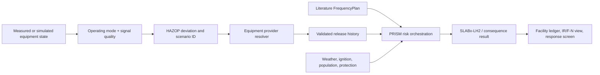

# PRISM

**Process Risk Integration and Scenario Modeling**

PRISM is a Python research framework for connecting process and equipment state, HAZOP deviations, literature-based initiating frequencies, equipment release histories, hydrogen dispersion, and conditional facility risk views.

[](https://pypi.org/project/prism-risk/)
[](https://www.python.org/)
[](LICENSE)

## Start here

Install the latest published package:

```powershell
python -m pip install "prism-risk[test]==0.6.3"
prism --describe-modes
```

From a source checkout:

```powershell
cd lh2-tno
python -m pip install -e ".[test]"
python scripts/verify_latest_ijhe_audit.py --output results/20261115/latest_ijhe_audit_verification.json
python -m pytest -q
```

Try the equipment boundary check:

```powershell
lh2-tno --equipment-manifest examples/equipment_manifest.json --output build/manifest_check.json
```

The v0.6.3 local validation result is **1243 passed, 1 warning**.

## What PRISM is for

PRISM helps an operator or researcher answer:

- Which HAZOP deviation is active for this equipment and operating mode?
- Which accident scenario and release port does that deviation select?
- Does a qualified equipment provider supply a time-resolved release history?
- Which literature frequency is bound to the event?
- What does SLABx-LH2 or another declared consequence backend calculate?
- What evidence, uncertainty, latency, and response action should be shown?

The framework supports generic outdoor LH2 facilities, including tanks, transfer lines, valves, pumps, vaporizers, and vents. It is designed to connect to an existing process digital twin. The equipment model remains the owner of thermodynamics, inventory, isolation, and accident release history.

For a compact multi-equipment demonstration, see the [native pump + valve facility campaign](docs/PRISM_native_multi_equipment_facility_campaign_20261016.md). It binds a liquid pump packet and a gas valve packet to one facility ledger, retains release duration and mass-balance evidence, and keeps every unmatched frequency opening explicitly `UNCOMPUTED`.

## What PRISM does not infer

PRISM does not infer leak size from pressure and temperature alone, convert normal flow into an accident history, learn an annual accident frequency from alarm counts, extend the last provider interval, or silently replace a missing provider with a similar case. These restrictions keep the risk result auditable.

## The system in one picture



There are two quantitative paths:

1. **Current-state path**: uses measured monitoring state and a cached or already-computed provider release for low-latency response.
2. **Predicted-state path**: uses a simulation state, reruns the provider/consequence chain when a declared risk condition is reached, and preserves `input_origin="model_prediction"`.

## Operating modes and HAZOP

Operating mode is part of the input, such as `receiving`, `supply`, or `standby`. The HAZOP table compares the state value with the row threshold and returns a stable `hazop_scenario_id`.

```json
{
  "id": "TK01-receiving-high-pressure",
  "component_id": "storage-tank-01",
  "operating_modes": ["receiving"],
  "variable_tag": "tank_pressure",
  "quantity": "pressure",
  "trigger": "at_or_above",
  "threshold_high_si": 600000.0,
  "scenario_family": "vessel_hole",
  "release_mode": "hole",
  "safeguards": ["PSV", "ESD"]
}
```

The scenario ID is preserved in the event, case, risk atom, and result ledger. HAZOP selection is qualitative; it does not create an annual frequency.

For a live facility batch, `FacilityRealtimeConsequenceMonitor.update_from_runtime_frames_with_hazop(...)`
combines the two boundaries in one explicit call. It requires exactly one state
frame per declared component, reads `operating_mode` from each frame, evaluates
the bound HAZOP table, dispatches each selected scenario to its matching
equipment release resolver, and then sends the validated release through the
existing realtime monitor and SLABx-LH2 consequence path. A missing or extra
frame is rejected before a provider is called. The returned
`realtime_hazop_bridge` records the selected scenario count and wall time, while
annual facility IR/F-N and frequency learning remain explicitly unavailable.

```python
result = facility_monitor.update_from_runtime_frames_with_hazop(
    hazop_table,
    runtime_frames_by_component,
    now_s=clock_s,
    release_resolvers={
        (component_id, scenario_id): provider_resolver,
    },
)
```

This is the recommended current-state control-room path: monitoring data and
operating mode enter together, HAZOP chooses the qualitative scenario, and the
provider owns release geometry, isolation, duration, and inventory depletion.
The result is a diagnostic current-weather view until the reviewed annual
campaign, provider qualification, and independent validation gates are closed.

The repository includes a three-component reconstructed facility replay that
exercises this coordinator end to end:

```powershell
python scripts/run_inspection_center_facility_hazop_bridge.py
```

It sends receiving, standby, and supply frames as one batch. The first two
remain `WITHHELD_HAZOP_NO_DEVIATION`; only the explicitly mapped supply
vaporizer branch reaches the provider packet and SLABx-LH2/TNO consequence
chain. The generated record is
`examples/inspection_center_facility_hazop_bridge.json`, with the method,
evidence boundary, and interpretation documented in
[`PRISM_검사센터_시설HAZOP_브리지_20261017.md`](docs/PRISM_검사센터_시설HAZOP_브리지_20261017.md).

The selected bridge branch can then be handed to the annual weather/population
and facility-ledger boundary:

```powershell
python scripts/build_inspection_center_facility_campaign_handoff.py
```

This keeps normal components as explicit `WITHHELD_NORMAL` coverage and
records the known conditional contribution without promoting it to a complete
facility IR/F-N result. See
[`PRISM_inspection_center_facility_campaign_handoff_20261017.md`](docs/PRISM_inspection_center_facility_campaign_handoff_20261017.md).

Run the narrow IJHE traceability audit for the same reconstructed handoff:

```powershell
python scripts/audit_inspection_center_facility_ijhe_handoff.py
```

`PASS_WITH_SCOPE_LIMITATIONS` means the bridge, explicit annual condition,
provider mapping, and literature-frequency sensitivity are internally
traceable. It does not mean that facility-wide IR/F-N, qualified provider
packets, or physical validation are complete. The JSON record is
[`inspection_center_facility_ijhe_handoff_audit.json`](examples/inspection_center_facility_ijhe_handoff_audit.json),
and the reusable implementation is
[`inspection_center_facility_ijhe_audit.py`](src/lh2_tno/inspection_center_facility_ijhe_audit.py).
The full IJHE audit can consume this record with
`--inspection-center-facility-ijhe-handoff-audit`; it appears as a
`diagnostic_only` check and does not weaken the strict facility-QRA gates.

## Equipment and provider boundary

The state frame contains facility ID, component ID, operating mode, timestamp, measured or predicted values, units, signal quality, and provenance. It does not contain `resolved_release`, opening diameter, annual frequency, duration, or termination basis.

The provider returns a strict release packet with interval time, mass flow, pressure, temperature, density, effective area, velocity, phase, inventory, termination evidence, and a source digest. The adapter validates the packet as `prism.resolved_release.v1`.

The supported termination bases include:

- `reviewed_isolation_success`
- `inventory_depletion`
- `model_pressure_equalization`
- `two_sided_rupture`
- `emergency_relief_discharge`
- `synthetic_diagnostic_horizon` (diagnostic horizon only)

## Frequency binding

Frequency is a separate, explicit `FrequencyPlan` input. The normal matching key is:

```text
event_id + component_id + port_id + scenario_family + release_branch_id
```

The plan records the citation, population or length basis, failure profile, units, applicability, uncertainty, and exclusions. A sensor anomaly count is not a frequency source unless a separate validated statistical study says so.

## Result status

Results expose evidence status instead of hiding it:

```json
{
  "status": "EXECUTED_OPERATOR_LIMITED",
  "provider_release_resolved": true,
  "termination": {"basis": "reviewed_isolation_success", "time_s": 0.2},
  "inventory": {"status": "MASS_BALANCE_CLOSED"},
  "frequency_inference_performed": false,
  "facility_qra_claim": false
}
```

`EXECUTED_OPERATOR_LIMITED` means the requested chain ran with declared limitations. `PROVIDER_REQUIRED`, `BLOCKED`, and `INCOMPLETE_EVIDENCE` are actionable states and must remain visible to the operator.

## Recommended monitoring screen

Show the facility, component, port, operating mode, HAZOP deviation, current/predicted state, provider status, source digest, release termination, remaining inventory, frequency citation, uncertainty range, consequence backend, cache/fresh flag, latency, and required response. Keep measured and predicted results visually and semantically distinct.

## Documentation

- [English user manual](docs/PRISM_USER_MANUAL_en.md)
- [English interface integration guide](docs/PRISM_INTERFACE_INTEGRATION_GUIDE_en.md)
- [Korean user manual](docs/PRISM_USER_MANUAL_ko.md)
- [Korean interface integration guide](docs/PRISM_INTERFACE_INTEGRATION_GUIDE_ko.md)
- [Korean README](README_ko.md)
- [IJHE requirement traceability](docs/PRISM_IJHE_requirement_traceability_20261115.md)
- [Latest IJHE audit](docs/PRISM_IJHE_latest_audit_20261115.md)
- [Latest facility-handoff IJHE audit detail](docs/PRISM_IJHE_facility_handoff_audit_20261115.md)
- [Latest IJHE audit metadata verifier](src/lh2_tno/latest_ijhe_audit_verification.py)
- [Receptor-geometry interpretation](docs/PRISM_receptor_geometry_interpretation_20261115.md)
- [Equipment provider state handoff](docs/PRISM_equipment_provider_state_handoff_20261115.md)
- [Current external release-artifact intake](docs/PRISM_external_release_artifact_intake_20261016.md)
- [Inspection-centre reviewed-unit re-audit](docs/PRISM_검사센터_검토단위_재감사_20261016.md)
- [Inspection-centre reconstructed-state connection](docs/PRISM_검사센터_재구성상태_연결_20261016.md)
- [Inspection-centre reconstructed HAZOP-to-consequence diagnostic chain](examples/inspection_center_reconstructed_hazop_provider_consequence_chain.json)
- [Inspection-centre reconstructed chain audit](examples/inspection_center_reconstructed_hazop_chain_audit.json)
- [Inspection-centre facility HAZOP bridge replay](examples/inspection_center_facility_hazop_bridge.json)
- [Inspection-centre facility HAZOP bridge record](docs/PRISM_검사센터_시설HAZOP_브리지_20261017.md)
- [Inspection-centre facility campaign handoff](examples/inspection_center_facility_campaign_handoff.json)
- [Inspection-centre facility campaign handoff record](docs/PRISM_inspection_center_facility_campaign_handoff_20261017.md)
- [Native multi-equipment facility campaign](docs/PRISM_native_multi_equipment_facility_campaign_20261016.md)
- [v0.6.3 distribution record (English)](docs/PRISM_v063_PyPI_DOI_DISTRIBUTION_RECORD_20261015.md)
- [v0.6.3 distribution record (Korean)](docs/PRISM_v063_PyPI_DOI_배포기록_20261015.md)

## Release links

- [GitHub Release v0.6.3](https://github.com/lyullee/prism/releases/tag/v0.6.3)
- [PyPI prism-risk 0.6.3](https://pypi.org/project/prism-risk/0.6.3/)
- [Reserved Zenodo v0.6.3 DOI](https://doi.org/10.5281/zenodo.23387052) (resolves after final publication)
- [PRISM concept DOI](https://doi.org/10.5281/zenodo.23241358)
- [PyPI workflow run](https://github.com/lyullee/prism/actions/runs/38689574587)

## Reproducibility checklist

Save the exact state frame, HAZOP row, provider response and digest, `FrequencyPlan` revision, weather/ignition/population/protection inputs, package version/commit, and result ledger. Compare reruns by event ID, case ID, risk atom ID, and provider digest rather than only by a rounded total.

```powershell
python scripts/verify_latest_ijhe_audit.py --output results/20261115/latest_ijhe_audit_verification.json
python -m pytest -q
```

The latest geometry diagnostic explains why the full union can show zero at
the declared 20 m worker receptor while a separate 0.5 m replay reaches one
harm atom. The records remain separate and diagnostic-only; the near-receptor
value is never substituted into the facility total. See
[`PRISM_receptor_geometry_interpretation_20261115.md`](docs/PRISM_receptor_geometry_interpretation_20261115.md).

## Current qualification boundary

PRISM v0.6.3 is research software for a diagnostic risk chain. It is not a regulatory certification, a complete facility QRA, an independent physical validation, or a claim of fresh physics at 1 Hz. The current IJHE audit remains fail-closed: four evidence gates are blocked and facility IR/F-N promotion is false. The status is recorded in `CURRENT_STATUS.json` and the audit documents.

## License and citation

PRISM is released under the MIT License. Please cite the version DOI after the Zenodo draft is finally published:

```text
Lee, Ugwiyeon. PRISM: Process Risk Integration and Scenario Modeling, v0.6.3.
Reserved DOI: https://doi.org/10.5281/zenodo.23387052
```
