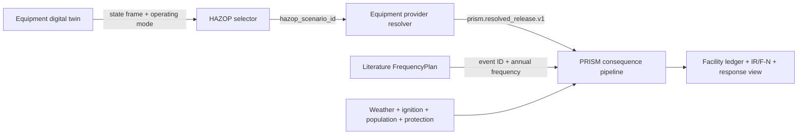

# PRISM Equipment and Digital-Twin Interface Guide (v0.6.4)

This guide defines the boundary between an equipment digital twin, HAZOP logic, a release provider, PRISM, and the SLABx-LH2 consequence model. It is intended for an integration engineer building a monitoring or simulation connector for a generic outdoor LH2 facility.

## 0. Public backend runtime preflight

PRISM can run with the public `prism_qra` source tree and explicitly supplied
external provider trees. Older diagnostic manifests may contain a legacy
`tno` package pin. That pin is not required by the public package and can fail
with `revision mismatch: tno` when it points to an obsolete development
checkout. Build a fresh configuration before starting a facility campaign.

```powershell
python scripts/build_backend_config.py `
  --interpreter "C:\path\to\python.exe" `
  --package slabx_lh2="C:\path\to\slabx_lh2" `
  --package dynamiclh2poolx="C:\path\to\dynamiclh2poolx" `
  --package slabx="C:\path\to\slabx" `
  --output results/backend_config.json

python scripts/check_backend_runtime.py `
  --backend-config results/backend_config.json `
  --output results/backend_runtime_check.json
```

`prism_qra` is automatically pinned from the current public checkout. The
repeatable `--package name=path` options are for provider or consequence
packages that an integrator owns or is licensed to use; their source trees are
not copied into this repository. The preflight checks source digests,
dependency versions, and a minimal isolated worker request. It performs no
risk calculation, does not infer frequencies, and never promotes provider or
facility evidence. Continue to a campaign only when the result is
`BACKEND_RUNTIME_READY`.

## 1. Responsibility boundary

The equipment model owns thermodynamics, hydraulics, inventory, isolation behavior, and the accident release history. PRISM owns HAZOP scenario selection, literature frequency binding, consequence orchestration, ignition/weather/population branches, and risk ledgers.



PRISM does not infer a leak size from pressure and temperature alone, infer an accident history from normal flow, learn an annual frequency from alarm counts, extend a provider interval, or replace a missing accident with a similar-looking case.

## 2. Recommended call sequence

1. The digital twin evaluates the current or simulated equipment state.
2. The connector writes operating mode, values, timestamp, signal quality, and provenance to `prism.hazop_state_frame.v1`.
3. The HAZOP table selects a deviation row and stable `hazop_scenario_id`.
4. The resolver receives the scenario and state snapshot.
5. The provider calculates and returns the accident release history, isolation feedback, inventory ledger, and source digest.
6. An adapter validates the provider output as `prism.resolved_release.v1`.
7. PRISM exact-matches the event to the literature frequency plan and runs SLABx-LH2 or the declared consequence backend.
8. The result ledger returns status, latency, cache/fresh mode, termination, inventory, frequency provenance, and evidence limitations.

## 3. State-frame contract

The state frame contains state only. It may include a measured or predicted value, its unit, signal quality, timestamp, source provenance, component ID, facility ID, and operating mode.

```json
{
  "schema_version": "prism.hazop_state_frame.v1",
  "facility_id": "terminal-01",
  "component_id": "storage-tank-01",
  "operating_mode": "receiving",
  "captured_at_s": 172.0,
  "source_provenance": "historian_measured",
  "values": {
    "tank_pressure": {
      "quantity": "pressure",
      "value_si": 650000.0,
      "sensor_location": "storage-tank-01.vapour",
      "quality": "valid"
    },
    "transfer_flow": {
      "quantity": "mass_flow",
      "value_si": 0.18,
      "sensor_location": "transfer-line-01",
      "quality": "valid"
    }
  }
}
```

Do not place `resolved_release`, opening diameter, annual frequency, release duration, or termination basis in the state frame. Those fields belong to the scenario/provider and frequency contracts.

### 3.1 Explicit observed-to-provider component mapping

An observed tag may use a site asset ID while the equipment model uses a
different provider ID. In that case, declare the mapping on the facility
binding instead of matching by name or guessing from geometry:

```python
FacilityRealtimeBinding(
    component_id="lh2-supply-vaporizer-boundary",
    template=template_for_observed_component,
    monitor=monitor,
    normalizer=normalizer,
    pressure_tag="PT1111",
    temperature_tag="TT1116",
    provider_component_id="ambient-vaporizer-01",
)
```

The HAZOP selector continues to evaluate the observed component. Only the
provider handoff receives an explicit translated state snapshot and template,
and their digests are recomputed. This mapping does not create release
geometry, duration, inventory, frequency, or facility risk; the provider must
still return a contract-valid accident history.

## 4. HAZOP binding

Compare the state value and operating mode with the HAZOP row. Preserve the selected row ID, operating mode, deviation, and safeguard context downstream.

```json
{
  "id": "TK01-receiving-high-pressure",
  "component_id": "storage-tank-01",
  "operating_modes": ["receiving"],
  "variable_tag": "tank_pressure",
  "quantity": "pressure",
  "trigger": "at_or_above",
  "threshold_high_si": 600000.0,
  "scenario_family": "vessel_hole",
  "release_mode": "hole",
  "safeguards": ["PSV", "ESD"]
}
```

HAZOP selection is a qualitative decision. It does not create or update an annual initiating frequency.

### 4.1 Multiple active HAZOP branches

If the same runtime frame activates more than one reviewed HAZOP row, bind the
literature rates by the exact scenario ID. Do not put one component-level rate
on all branches:

```python
FacilityRealtimeBinding(
    component_id="storage-tank-01",
    template=template,
    monitor=monitor,
    normalizer=normalizer,
    pressure_tag="PT-01",
    temperature_tag="TT-01",
    scenario_frequency_bindings={
        "TK01-receiving-vessel-hole:receiving:vessel_hole": vessel_frequency,
        "TK01-receiving-liquid-two-phase:receiving:liquid_two_phase": liquid_frequency,
    },
)
```

Each provider resolver remains keyed by `(component_id, scenario_id)`. The
runtime result echoes the selected branch's frequency event ID and source
digest. If a selected scenario has no exact frequency entry, its risk atom is
withheld and the branch is reported as
`WITHHELD_MISSING_SCENARIO_BINDING`; no frequency is inferred from telemetry.

When one observed component can select branches owned by different equipment
models, provide an equally explicit provider identity map:

```python
FacilityRealtimeBinding(
    component_id="shared-observed-boundary",
    template=template,
    monitor=monitor,
    normalizer=normalizer,
    pressure_tag="PT-01",
    temperature_tag="TT-01",
    provider_component_ids_by_scenario={
        "high-pressure:vessel_hole": "tank-provider-01",
        "high-pressure:liquid_two_phase": "transfer-line-provider-01",
    },
)
```

For each selected scenario, PRISM translates the state snapshot and request
template to the declared provider ID before calling the resolver. A missing
entry is returned as `WITHHELD_PROVIDER_IDENTITY_MAPPING`; another branch's
provider ID is never reused. This allows a shared sensor boundary to fan out to
different tank, pipe, valve, or vaporizer models while keeping the HAZOP
component identity and provider identity separately auditable.

## 5. Provider release contract

The provider response must identify the event, component, accident port, source digest, release intervals, inventory, and termination evidence.

```json
{
  "provider_export_schema": "prism.external_accident_history.v1",
  "data": {
    "event_kind": "accidental_leak",
    "duration_s": 0.2,
    "available_mass_kg": 71.76,
    "cumulative_mass_out_kg": 0.003,
    "termination_basis": "reviewed_isolation_success",
    "termination_provenance": "provider isolation feedback",
    "steps": [
      {
        "time_s": 0.0,
        "mass_flow_kg_s": 0.03,
        "pressure_pa_abs": 101325.0,
        "specific_enthalpy_j_kg": 450000.0,
        "temperature_k": 20.7,
        "density_kg_m3": 1.28,
        "effective_area_m2": 0.0001,
        "velocity_m_s": 234.0,
        "area_provenance": "provider resolved outlet",
        "velocity_origin": "provider_resolved"
      }
    ]
  }
}
```

The adapter checks time ordering, mass balance, area, density, velocity, units, source digest, and event identity. It does not extend the provider duration or correct a residual.

### 5.1 Port state and upstream state

When the equipment model can provide upstream pressure/enthalpy and phase, preserve them in every matching interval.

```json
{
  "component_id": "storage-tank-01",
  "port_id": "tank-accident-out",
  "time_s": 0.0,
  "fluid": "ParaHydrogen",
  "phase": "two_phase",
  "pressure_pa_abs": 650000.0,
  "temperature_k": 20.4,
  "density_kg_m3": 34.0,
  "specific_enthalpy_j_kg": 120000.0,
  "mass_flow_kg_s": 0.03,
  "position_enu_m": [0.0, 0.0, 5.0],
  "direction_enu": [1.0, 0.0, 0.0],
  "provenance": "lh2dt tank port state",
  "source_digest": "0123456789abcdef0123456789abcdef0123456789abcdef0123456789abcdef"
}
```

Optional `provider_source_state` can carry source and throat pressure, temperature, density, enthalpy, entropy, mass flux, choking state, and provenance. The adapter rejects a component, port, time, fluid, phase, or mass-flow mismatch.

### 5.2 Termination and inventory

Use the provider-calculated termination basis:

- `reviewed_isolation_success`: command and feedback closed;
- `inventory_depletion`: provider-calculated inventory end;
- `model_pressure_equalization`: model natural end;
- `two_sided_rupture`: both rupture ends closed together;
- `emergency_relief_discharge`: relief or PSV path;
- `synthetic_diagnostic_horizon`: diagnostic window, not a physical end.

Include initial mass, cumulative outflow, final mass, residual, isolation time, and observation horizon in `provider_meta` whenever available. An unresolved residual must remain visible in the result.

### 5.3 Dynamic LH2 source-state closure

For a gas, liquid, or two-phase accident release, a closed atmospheric mass
integral does not by itself prove that the equipment model changed tank
pressure and inventory
while calculating the leak. To remove the source-dynamics `operator_limited`
flag, add the optional `provider_meta.dynamic_state_closure` object described
in the [dynamic closure contract](PRISM_dynamic_liquid_state_closure_contract_en.md).
It must include:

- explicit `inventory_feedback_closed=true` and `pressure_feedback_closed=true`;
- a 64-character state-history digest;
- inventory and pressure residuals with provider-declared tolerances; and
- a provider mass ledger that closes from initial state to final state.

The packet must also carry a compatible reviewed termination basis. Missing or
invalid fields leave the source `EXECUTED_OPERATOR_LIMITED`; PRISM never
reconstructs tank dynamics from outlet flow. The same check is applied to
accidental gas and emergency-relief packets; normal operating vents do not
require it. Clearing this source flag still
does not qualify the provider, frequency, or facility IR/F-N result.

After a campaign, the case row carries `dynamic_state_closure_status`, and the
facility ledger exposes global and per-component status counts. Use these
counts to select equipment that is ready for a dynamic release review and to
request missing provider evidence. Do not treat `READY` as provider
qualification; exact packet evidence and independent physical validation are
separate gates.

The public `lh2dt_models` exporters implement this contract for the dynamic
equipment classes. Use commit
[`16f7a4b`](https://github.com/lyullee/lh2dt_models/commit/16f7a4b) or a later
release of that repository. `DynamicHEMPipe`, `LayeredTank`, and
`DynamicVaporizer` hash their provider-owned state histories and report both
residual pairs. Their packets can therefore pass the source-dynamics check
when the declared termination and provider-qualification gates also pass.
`MappedPump`, `Valve`, and `VentStack` remain fixed-source boundaries: their
upstream inventory must be supplied by a separate dynamic equipment provider,
so their omission of `dynamic_state_closure` is intentional and remains
operator-limited.

PRISM currently retains three native diagnostic handoffs under
`results/20261115/`: `native_dynamic_pipe_closure_check_current`,
`native_layered_tank_closure_check_current`, and
`native_dynamic_thermal_closure_check_current`. All three preserve the
provider digest and report `READY` for source dynamics after reviewed
isolation. The records are still synthetic and do not promote frequency,
physical validation, or facility IR/F-N claims.

The seven-equipment replay at
`results/20261115/native_external_multi_equipment_chain_recheck_current/manifest.json`
consumes those resolved-release packets through the ordinary SLABx-LH2 path
for six equipment rows and the compressible-plane adapter for the valve row.
The manifest copies the provider-owned closure object for the four dynamic
equipment rows so a downstream audit can verify the exact state-history
digest. This is an end-to-end diagnostic replay; it does not create an
initiating frequency or open provider, physical-validation, or facility-QRA
promotion gates.

## 6. Python resolver example

```python
from lh2_tno.equipment_release_adapter import (
    build_resolved_gas_release_from_provider_response,
)
from lh2_tno.service import request_from_equipment_resolver


def resolver(template, state_frame):
    provider_response = twin.export_accident_history(
        component_id=template.component_id,
        operating_mode=state_frame["operating_mode"],
        state=state_frame,
    )
    release = build_resolved_gas_release_from_provider_response(
        provider_response,
        component_id=template.component_id,
        port_id="tank-accident-out",
        event_id="terminal-01/tank-accident-out/area-0.01pct",
        provider_source_digest=provider_response["provider_source_digest"],
        upstream_service_provenance="lh2dt provider",
        provider_boundary_reference="tank outlet boundary",
        input_origin="model_prediction",
        position_enu_m=[0.0, 0.0, 5.0],
        direction_enu=[1.0, 0.0, 0.0],
        ambient_pressure_pa_abs=101325.0,
        ambient_temperature_k=288.15,
        failure_opening_diameter_m=0.0127,
    )
    return template.model_copy(update={
        "source_input": None,
        "resolved_release": release,
        "release_termination": {
            "basis": release.termination_basis,
            "time_s": release.duration_s,
            "provenance": release.termination_provenance,
        },
    })


request = request_from_equipment_resolver(
    consequence_template,
    state_frame,
    resolver,
    pressure_tag="PT1105A",
    temperature_tag="TT1106",
)
```

The resolver should never write `annual_frequency_per_year`. Frequency binding belongs to the campaign and `FrequencyPlan` layer.

## 7. Frequency binding

Bind literature frequency using:

```text
event_id + component_id + port_id + scenario_family + release_branch_id
```

Record source citation, population or length basis, failure profile, units, applicability, uncertainty, and exclusions. Keep sensor anomaly counts and normal flow outside the frequency plan unless a separate validated statistical study explicitly defines them as a frequency source.

### 7.1 Facility aggregation of simultaneous HAZOP branches

When several components are evaluated in one facility snapshot, a HAZOP row ID
may be reused by more than one component. The facility branch handoff therefore
uses the canonical key:

```text
component_id|hazop_scenario_id
```

Pass this key to both `branch_probabilities` and
`branch_partition_groups` in `build_hazop_facility_campaign_branches(...)`:

```python
branch_probabilities={
    "tank-01|high-pressure:receiving:vessel_hole": 0.5,
    "transfer-line-01|high-pressure:receiving:vessel_hole": 0.5,
}
branch_partition_groups={
    "tank-01|high-pressure:receiving:vessel_hole": "shared-deviation",
    "transfer-line-01|high-pressure:receiving:vessel_hole": "shared-deviation",
}
```

The probabilities must close to one within each named partition group. A bare
scenario ID is accepted only when it occurs on one component; if it is reused,
PRISM requires the canonical key and fails closed. This prevents an event rate
or branch probability from moving between tanks, pipes, valves, or vaporizers.
The resulting ledger is still diagnostic until provider qualification,
physical validation, and the declared facility scope gates are closed.

## 8. Result contract and user interface

```json
{
  "status": "EXECUTED_OPERATOR_LIMITED",
  "operating_mode": "receiving",
  "hazop_scenario_id": "TK01-receiving-high-pressure",
  "event_id": "terminal-01/tank-accident-out/area-0.01pct",
  "provider_release_resolved": true,
  "termination": {"basis": "reviewed_isolation_success", "time_s": 0.2},
  "inventory": {"status": "MASS_BALANCE_CLOSED", "remaining_mass_kg": 71.75},
  "frequency_inference_performed": false,
  "facility_qra_claim": false
}
```

The monitoring screen should show operating mode, HAZOP deviation, provider status, source digest, termination, inventory, frequency citation, consequence backend, cache/fresh mode, latency, and required response. `facility_qra_claim=false` and `frequency_inference_performed=false` are safety guards, not errors.

For a conditional realtime facility handoff, read `campaign.timing.case_count`,
`case_min_ms`, `case_median_ms`, `case_p95_ms`, and `case_p99_ms` from the
same result ledger. These are measured wall-clock samples for the cases in that
single snapshot. They describe observed processing time and do not establish a
fresh-physics 1 Hz service guarantee; the result continues to expose
`one_hz_fresh_physics_demonstrated=false` unless a separate validated benchmark
opens that claim.

## 9. Acceptance tests

After connecting a provider, automatically check:

- state frame contains no accident-only fields;
- operating mode matches the HAZOP row;
- scenario ID is retained in event, case, and risk atom;
- packet schema is `prism.resolved_release.v1`;
- interval time, mass, and energy ledgers close;
- port state agrees with interval ID, phase, and flow;
- termination and isolation evidence exist;
- source and result digests are recorded;
- frequency binding is exact-match;
- missing providers are not silently substituted;
- SLABx-LH2 and IR/F-N are labeled conditional.

```powershell
python -m pytest -q tests/test_equipment_release_adapter.py tests/test_equipment_boundary.py tests/test_consequence_service.py
python -m pytest -q
```

## 10. Integration limits

This is a generic LH2 interface and is not tied to one inspection center. Normal operating data must not be promoted automatically to accident evidence. A facility-wide IR/F-N claim requires qualified packets for the declared cases, complete termination and inventory ledgers, independent physical validation, and facility population/protection inputs. The current audit remains fail-closed while those evidence gates are incomplete.
