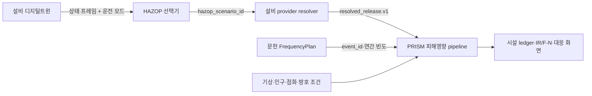

# PRISM 설비 디지털트윈 인터페이스 연결 가이드 (v0.6.3)

## 1. 연결 원칙

PRISM은 설비 디지털트윈의 내부 압력·열·유량 계산을 대신하지 않는다. 설비 모델은 상태와 사고 방출 이력을 소유하고, PRISM은 HAZOP 선택, 문헌 빈도 결합, SLABx-LH2 피해영향, 점화·인구·IR/F-N 집계를 담당한다.



PRISM은 다음을 자동 추정하지 않는다.

- 센서 압력·온도만으로 누출 크기
- 정상 유량만으로 사고 방출 이력
- 센서 이상 횟수만으로 사고빈도
- 마지막 provider interval을 임의로 연장한 방출 지속시간
- 누락된 사고를 유사 사고로 대체한 위험값

## 2. 권장 호출 순서

1. 설비 모델이 현재 상태를 계산한다.
2. `prism.hazop_state_frame.v1` 상태 프레임에 운전 모드와 신호 품질을 기록한다.
3. HAZOP 표가 이탈 row와 `hazop_scenario_id`를 선택한다.
4. 선택된 scenario와 상태 snapshot을 provider resolver에 전달한다.
5. provider가 방출 시간 이력과 종료·재고 evidence를 반환한다.
6. adapter가 `prism.resolved_release.v1`을 strict 검증한다.
7. PRISM이 문헌 event와 exact-match한 뒤 SLABx-LH2와 최종 피해 계산을 실행한다.
8. realtime ledger가 latency, cache/fresh mode, termination, inventory, evidence status를 반환한다.

## 3. 상태 프레임 계약

최소 예시:

```json
{
  "schema_version": "prism.hazop_state_frame.v1",
  "facility_id": "terminal-01",
  "component_id": "storage-tank-01",
  "operating_mode": "receiving",
  "captured_at_s": 172.0,
  "source_provenance": "historian_measured",
  "values": {
    "tank_pressure": {
      "quantity": "pressure",
      "value_si": 650000.0,
      "sensor_location": "storage-tank-01.vapour",
      "quality": "valid"
    },
    "transfer_flow": {
      "quantity": "mass_flow",
      "value_si": 0.18,
      "sensor_location": "transfer-line-01",
      "quality": "valid"
    }
  }
}
```

허용되는 상태값은 설비 상태·신호 품질·운전 모드다. `resolved_release`, `failure_opening_diameter_m`, `annual_frequency_per_year`, `duration_s`, `termination_basis`를 상태 프레임에 넣지 않는다.

## 4. HAZOP 계약

HAZOP row는 운전 모드와 함께 비교한다.

```json
{
  "id": "TK01-receiving-high-pressure",
  "component_id": "storage-tank-01",
  "operating_modes": ["receiving"],
  "variable_tag": "tank_pressure",
  "quantity": "pressure",
  "trigger": "at_or_above",
  "threshold_high_si": 600000.0,
  "scenario_family": "vessel_hole",
  "release_mode": "hole",
  "safeguards": ["PSV", "ESD"]
}
```

선택된 row의 `hazop_scenario_id`와 `operating_mode`는 이후 event, case, risk atom과 함께 보존한다. HAZOP 선택은 사고빈도를 생성하지 않는다.

## 5. Provider 방출 계약

### 5.1 기체 경계

provider response는 `data.steps`에 구간 시작시간과 방출 경계를 보낸다.

```json
{
  "provider_export_schema": "prism.external_accident_history.v1",
  "data": {
    "event_kind": "accidental_leak",
    "duration_s": 0.2,
    "available_mass_kg": 71.76,
    "cumulative_mass_out_kg": 0.003,
    "termination_basis": "reviewed_isolation_success",
    "termination_provenance": "provider isolation feedback",
    "steps": [
      {
        "time_s": 0.0,
        "mass_flow_kg_s": 0.03,
        "pressure_pa_abs": 101325.0,
        "specific_enthalpy_j_kg": 450000.0,
        "temperature_k": 20.7,
        "density_kg_m3": 1.28,
        "effective_area_m2": 0.0001,
        "velocity_m_s": 234.0,
        "area_provenance": "provider resolved outlet",
        "velocity_origin": "provider_resolved"
      }
    ]
  }
}
```

각 interval의 질량·면적·밀도·속도는 연속방정식을 닫아야 한다. PRISM은 provider가 선언한 duration과 steps를 임의로 늘리지 않는다.

### 5.2 설비 포트 상태 보존

상류 P/h와 phase를 함께 전달할 때 `provider_port_state`를 각 interval에 넣는다.

```json
{
  "component_id": "storage-tank-01",
  "port_id": "tank-accident-out",
  "time_s": 0.0,
  "fluid": "ParaHydrogen",
  "phase": "two_phase",
  "pressure_pa_abs": 650000.0,
  "temperature_k": 20.4,
  "density_kg_m3": 34.0,
  "specific_enthalpy_j_kg": 120000.0,
  "mass_flow_kg_s": 0.03,
  "position_enu_m": [0.0, 0.0, 5.0],
  "direction_enu": [1.0, 0.0, 0.0],
  "provenance": "lh2dt tank port state",
  "source_digest": "0123456789abcdef0123456789abcdef0123456789abcdef0123456789abcdef"
}
```

기체 경계에서는 phase가 `vapour` 또는 `two_phase`, 액체/2상 경계에서는 `liquid` 또는 `two_phase`여야 한다. component, port, time, fluid, mass flow가 방출 구간과 다르면 adapter가 거부한다.

상류·throat 상태를 보존하려면 다음 선택 필드를 추가한다.

```json
{
  "provider_source_state": {
    "source_pressure_pa_abs": 650000.0,
    "source_temperature_k": 20.4,
    "source_density_kg_m3": 34.0,
    "source_specific_enthalpy_j_kg": 120000.0,
    "source_specific_entropy_j_kgk": 5000.0,
    "throat_pressure_pa_abs": 101325.0,
    "throat_temperature_k": 20.7,
    "throat_density_kg_m3": 1.28,
    "throat_specific_enthalpy_j_kg": 450000.0,
    "throat_mass_flux_kg_m2_s": 300.0,
    "choked": true,
    "provider_source_state_provenance": "lh2dt throat calculation"
  }
}
```

### 5.3 종료·재고 계약

`termination_basis`는 provider가 실제로 계산한 종료 이유를 나타낸다.

- `reviewed_isolation_success`: 차단 명령과 feedback이 닫힘
- `inventory_depletion`: provider가 선언한 재고 종료 기준
- `model_pressure_equalization`: 모델 자연 종료
- `two_sided_rupture`: 양단 파열 공동 종료
- `emergency_relief_discharge`: PSV/relief 방출
- `synthetic_diagnostic_horizon`: 진단 시간창일 뿐 실제 종료 아님

`provider_meta`에는 가능하면 초기질량, 누적 방출량, 최종질량, 잔차, 차단시각, 관찰시간을 넣는다. 잔차가 맞지 않으면 PRISM은 값을 고치지 않고 evidence를 제한한다.

## 6. Python resolver 연결 예시

```python
from lh2_tno.equipment_release_adapter import (
    build_resolved_gas_release_from_provider_response,
)
from lh2_tno.service import request_from_equipment_resolver


def resolver(template, state_frame):
    provider_response = twin.export_accident_history(
        component_id=template.component_id,
        operating_mode=state_frame["operating_mode"],
        state=state_frame,
    )
    release = build_resolved_gas_release_from_provider_response(
        provider_response,
        component_id=template.component_id,
        port_id="tank-accident-out",
        event_id="terminal-01/tank-accident-out/area-0.01pct",
        provider_source_digest=provider_response["provider_source_digest"],
        upstream_service_provenance="lh2dt provider",
        provider_boundary_reference="tank outlet boundary",
        input_origin="model_prediction",
        position_enu_m=[0.0, 0.0, 5.0],
        direction_enu=[1.0, 0.0, 0.0],
        ambient_pressure_pa_abs=101325.0,
        ambient_temperature_k=288.15,
        failure_opening_diameter_m=0.0127,
    )
    return template.model_copy(update={
        "source_input": None,
        "resolved_release": release,
        "release_termination": {
            "basis": release.termination_basis,
            "time_s": release.duration_s,
            "provenance": release.termination_provenance,
        },
    })

request = request_from_equipment_resolver(
    consequence_template,
    state_frame,
    resolver,
    pressure_tag="PT1105A",
    temperature_tag="TT1106",
)
```

실제 구현에서는 provider response의 event/component/port/source digest를 HAZOP binding과 exact-match하고, resolver가 `annual_frequency_per_year`를 넣지 않도록 한다. 문헌 빈도 binding은 별도 `FrequencyPlan`과 campaign 단계에서 수행한다.

## 7. 빈도 연결

빈도는 다음 키로 연결한다.

```text
event_id + component_id + port_id + scenario_family + release_branch_id
```

frequency plan에는 profile, count/length/diameter, 적용 범위, 문헌 출처와 제외 이유를 명시한다. 센서의 이상 빈도, alarm 발생 횟수, 정상 유량은 문헌 빈도를 대체하지 않는다.

## 8. PRISM 결과 계약

realtime 또는 campaign 결과에서 다음을 관리자 화면에 표시한다.

```json
{
  "status": "EXECUTED_OPERATOR_LIMITED",
  "operating_mode": "receiving",
  "hazop_scenario_id": "TK01-receiving-high-pressure",
  "event_id": "terminal-01/tank-accident-out/area-0.01pct",
  "provider_release_resolved": true,
  "termination": {"basis": "reviewed_isolation_success", "time_s": 0.2},
  "inventory": {"status": "MASS_BALANCE_CLOSED", "remaining_mass_kg": 71.75},
  "frequency_inference_performed": false,
  "facility_qra_claim": false
}
```

`facility_qra_claim=false`, `physical_validation_claim=false`, `frequency_inference_performed=false`는 정상적인 안전장치다. 이를 임의로 true로 바꾸지 않는다.

## 9. 인터페이스 수용시험

provider를 연결한 뒤 다음을 자동 검사한다.

- state frame이 사고 전용 필드를 포함하지 않음
- 운전 모드가 HAZOP binding과 일치함
- HAZOP scenario ID가 event/case/risk atom에 유지됨
- provider packet schema가 `prism.resolved_release.v1`임
- 모든 interval의 시간·질량·엔탈피 장부가 닫힘
- port state와 release interval의 ID·phase·유량이 일치함
- termination basis와 isolation feedback이 존재함
- source/result digest가 기록됨
- 문헌 frequency가 exact-match됨
- provider가 없는 사고를 자동 대체하지 않음
- SLABx-LH2 결과와 IR/F-N은 조건부 상태로 표시됨

로컬 검증:

```powershell
python -m pytest -q tests/test_equipment_release_adapter.py tests/test_equipment_boundary.py tests/test_consequence_service.py
python -m pytest -q
```

## 10. 현재 한계

현재 인터페이스는 일반 LH2 시설에 적용할 수 있는 공통 경계다. 특정 검사센터 태그나 정상 운전자료를 사고빈도·qualified release로 자동 변환하지 않는다. 실제 시설 전체 IR/F-N을 열려면 모든 선언 case에 qualified provider packet, 완전한 종료·재고 장부, 독립 물리검증, 시설 범위·인구·방호 자료가 필요하다.
