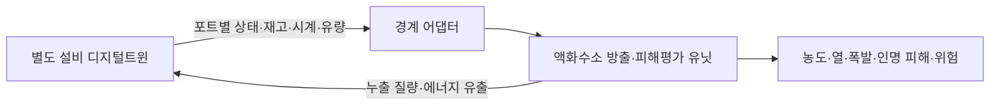

# 별도 설비 디지털트윈과 액화수소 위험평가 유닛 결합 검토

검토일: 2026-10-08. 대상 프로젝트: **액화수소검사지원센터 모델링**. 대상 세션: **액화수소 설비 디지털 트윈 모델링#2**.

## 최신 구현 보완 (2026-11-15)

이 문서의 2026-10-08 결론에서 후속 항목으로 남겼던 경계 상태 보존 중 일부를
PRISM `a0790d4a`에서 구현했다. `equipment_release_adapter`는 이제 외부 provider
JSON의 구간별 `provider_port_state`와 `provider_source_state`를 버리지 않고 strict
방출 packet에 보존하며, JSON 좌표 배열·P/h·상·질량유량·시간·digest를 검증한다.
따라서 **상태 handoff의 코드 경계는 연결되었지만**, 실제 설비의 qualified 사고
packet, 종료·재고 증거, 독립 물리검증과 시설 IR/F-N 승격은 여전히 별도 gate다.
전체 설명과 테스트 결과는 [`PRISM 설비 provider 상태 handoff 기록`](PRISM_equipment_provider_state_handoff_20261115.md)에 있다.

## 결론

**두 모델은 결합 가능한 구조다. 현재 완성된 결합은 아니며, 그대로 연결하면 포화 상태와 방출량 처리에서 문제가 발생한다.** 실제 출력물을 검토하고 두 종류의 모델 호출로 그 차이를 확인했다.

설비의 압력·온도·재고·유량·밸브 상태는 별도 프로젝트의 `lh2dt`가 계산하도록 한다. 이 프로젝트의 액화수소 유닛은 설비 경계에서 시작하는 방출·분산·화재·폭발·피해·위험을 담당한다. 설비 모델 전체를 TNO 쪽에서 다시 만드는 방식은 필요하지 않다.

현재 TNO에는 누출 계산용 간단한 탱크·배관·노즐 모델과 독립 벤트 부품 호출이 들어 있다. 시설 JSON은 설비와 연결을 표현하지만 전체 설비 네트워크의 동적 압력·열·유량을 푸는 모델은 아니다. 앞서 완료한 전체 연결은 방출부터 최종 피해까지의 진단 계산 경로다.

## 무엇을 검토했는가

- 지정 세션의 최근 4개 턴: 전체 연결, 비교시간축 수정, 하역/비상 절차, 현재 진행 중인 BOG 경로 및 밸브 전환 시각 처리.
- 최신 개발상태 문서, 설비 물성·네트워크·동적 상태 코드와 출력 계약.
- 전체 토폴로지와 8개 합성 시나리오의 질량·에너지 장부 결과.
- 차가운 BOG 직접 공급 경로와 밸브 전환 시각 검증 결과.
- 공식 센터 독립 검증 관문과 최근 압력 비교 결과.
- 20261008 전달 탱크 패키지: manifest의 **28개 파일 모두 SHA-256 일치**.
- 37쪽 쉬운 설명서: 내용 텍스트 검토. 문서의 시각적 배치를 재검증한 것은 아니다.

JSON/문서 총 13개 주요 출력물의 출처·해시·검토 스냅샷을 `results/20261008/equipment_coupling_review`에 기록했다. 별도 설비 프로젝트의 코드는 수정하지 않았다. 해당 세션이 계속 개발 중이므로 이 검토는 기록된 출력물과 실제 시험에 사용한 코드 버전의 상태를 뜻한다.

## 별도 프로젝트가 제공하는 것

| 항목 | 확인 내용 | 결합에서의 역할 |
|---|---|---|
| 탱크 | 균질·성층·층상 모델, 액체/기체/벽체 상태, 상변화 | 누출 위치가 속한 상의 압력·엔탈피·재고 제공 |
| 배관·밸브 | HEM 배관, 명령 밸브, 저항·유량·방향성 | 누출구 전단 상태, 차단 이벤트, 방출량 변화 |
| 기화기·열교환 | 출구 엔탈피, 열량, 별도 동적 모델 | 따뜻한 기체와 차가운 BOG의 다른 방출 상태 |
| 재액화·펌프 등 | 구성 모델과 screening 결합 | 운전 중 재고/에너지/유량 경계 |
| 정적 네트워크 | `NetworkSolution`, 노드 상태와 link별 유량/전달 엔탈피 | 실제 연결 부품의 출구 상태 추출 |
| 동적 네트워크 | `DynamicNetworkStepResult`, 상태·유량·누적 질량/에너지 | 공통 시계, 차단 전후 장부와 누출 피드백 |
| 별도 전달 패키지 | 3개 액체 셀·3개 기체 셀·벽체를 가진 탱크 재현본 | 탱크 경계 계약의 재현성 시험 |

전체 topology screening 출력에서는 21개 노드·27개 연결, 10개 모델 노드의 구성 가능성과 27개 연결 계약 통과가 기록됐다. 8개 합성 시나리오의 보존 검사도 출력 기록에서 통과로 확인했다. 이번 검토에서 8개 전체 시나리오를 재실행한 것은 아니다. 이는 연결 소프트웨어와 명시 입력의 보존 검사이며 센터 전체 현장 검증은 아니다.

20261008 탱크 전달본의 기하 계약은 gross volume 62.759 m³·정격 저장량 4,000 kg이다. 세션에 별도로 등장한 2톤 탱크 참고 도면과 혼용하거나 범용 시설의 기본값으로 사용하지 않는다.

## 실제로 확인한 결합 시험

### 1. 전달된 탱크 패키지 재실행

실제 20261008 패키지의 `run_smoke_test.py`를 재실행했다. 4초 폐쇄·평형 시험에서 `TANK_SMOKE_TEST_PASS`, 질량 잔차 0 kg, 에너지 잔차 0 J를 확인했다. 이 시험은 누출 과도나 센터 정확도를 증명하지 않는다.

이어 같은 패키지의 층상 탱크에서 액체 셀과 기체 셀을 직접 읽었다. Hydrogen와 ParaHydrogen 각각에 대해 총 4개 경계를 추출했다.

| 전달 방법 | 실제 시험 결과 | 의미 |
|---|---|---|
| 압력·엔탈피로 물성 복원 | 4/4 성공 | 액체/기체 상 정보 보존 가능 |
| 같은 압력·온도를 현재 HEM 입력에 전달 | 0/4 성공 | 포화 P,T에서 CoolProp의 상태 모호성으로 거절 |

**포화 액체와 포화 기체는 같은 압력·온도를 가질 수 있다.** 따라서 P,T만으로 연결하지 않는다. P,h와 phase/quality를 경계의 기준으로 사용해야 한다. 오류를 피하려고 온도를 조금 올리거나 내리는 처리는 설비 출력 상태를 바꾸므로 정상 결합 방법으로 사용하지 않는다.

실제 포화 끝점의 `phase` 문자열은 액체/기체 모두 `twophase`로 나왔다. 이름만 보고 50:50 액체·기체로 판단하지 않는다. 선택한 포트/셀과 quality=0 또는 quality=1을 함께 보존한다.

### 2. 실제 설비 네트워크의 벤트 출구 추출

현행 `SteadyNetwork`와 `VentStack`을 사용해 합성 벤트 경계를 풀었다. ParaHydrogen, 전단 400 kPa(abs)·150 K, 대기 101.325 kPa·288.15 K, 명시한 배관/열경계를 사용했다.

- 계산된 유량: 약 **0.141779 kg/s**.
- 계산된 실제 출구 온도: 약 **150.209 K**.
- 열량 장부 잔차: **0 W**.
- 시험 중 provider 소스 해시 변화 없음.

출구 상태는 link가 전달하는 `transmitted_specific_enthalpy_J_kg`와 실제 하류 압력으로 복원했다. 대기 boundary에 넣은 288.15 K를 유출 수소의 온도로 사용하면 결과가 달라진다. 탱크 전단 온도를 출구 온도로 쓰는 것도 부품의 열변화를 잃는다.

이 시험은 **설비 출력 추출 가능성**을 확인한 것이다. 이 출구를 현재 TNO 최종 피해 경로에 투입한 통합 시험은 아니다. 출력에 필요한 위치·방향·면적·속도 등이 아직 별도 연결값으로 남는다.

## 연결에서 반드시 맞춰야 할 사항

| 우선 항목 | 현재 차이/문제 | 필요한 처리 |
|---|---|---|
| 물성 기준 | 설비 기본값 ParaHydrogen, 현재 TNO 예제 Hydrogen. 풀 모델은 Hydrogen 고정 | 동일 fluid·EOS·에너지 기준을 명시. 이름만 바꾸거나 h를 다른 물성으로 해석하지 않음 |
| 포화 경계 | 현재 source는 P,T 기반 critical-flow 입력 | P,h 기반 HEM/HNEM 경계 입력 추가. phase/quality와 원래 상태 보존 |
| 계산 책임 | 현재 source 안에 간단한 탱크 전진 계산이 있음 | 설비 상태를 받는 경로에서는 내부 탱크 전진 계산을 사용하지 않음 |
| 이미 정해진 유량 | 설비 link에서 방출 유량을 계산한 경우 | resolved-source 입력 추가. 구멍 크기로 다시 유량을 계산하지 않음 |
| 상/위치 선택 | 층상·성층 탱크의 액체/기체 상태가 다름 | 실제 포트가 연결된 상과 셀을 명시. 평균 온도나 다른 상의 재고를 사용하지 않음 |
| 수직 벤트 | 현재 전체 피해 경로는 수직 전용 노즐을 거절 | 수직 근거리/SLAB 전달 경로 필요 |
| 사고와 운전 | 정상 기체 공급·BOG 회수·벤트 유량이 모두 존재 | 사건 ID와 normal vent/leak 구분. 모든 공급 유량을 사고 누출로 취급하지 않음 |
| 시계/차단 | 밸브 전환은 계산 간격 사이에서 일어남 | 이벤트 시각과 누적 장부를 전달. 종료 시점 유량 0만 보고 이전 방출 질량을 버리지 않음 |
| 누출 피드백 | 설비의 정상운전 출력만 재생하면 누출로 인한 재고/압력 감소가 빠짐 | 장시간 사고에는 leak edge를 네트워크에 추가하고 m·h 유출을 설비에 반영 |
| 공식 검증 | 현재 센터 공식 독립 관문은 8개 모두 차단, 호출 0회 | 합성 결합 통과와 현장 정확도를 따로 기록 |

특히 기존 `stratified_tank_node`는 한 동적 노드에 액체 또는 기체 한 상의 경계를 명시적으로 선택한다. 한 탱크의 액체 인출과 기체 벤트가 동시에 작동하는 결합에서는 다중 상 포트 처리와 액체/기체 장부를 확인해야 한다. 이를 단일 평균 탱크 상태로 바꾸면 해당 모델의 장점을 잃는다.

## 권장 연결 구조

두 가지 입력 모드를 분리한다.

1. **전단 상태 모드:** 설비가 P,h,상,재고를 준다. 위험평가 쪽이 실제 누출구의 방출량을 계산한다. 누출 edge가 설비 장부와 공유하는 동일 방출 계산을 사용한다.
2. **계산된 방출 모드:** 설비의 벤트/보호밸브/누출 edge가 유량과 출구 상태를 이미 계산했다. 위험평가 쪽은 이를 그대로 받아 액적·분산·피해 계산을 시작한다.

현재 `ResearchPipeline.consequences()`는 storage_tank 기반 단일 source 입력을 요구한다. 위 두 모드를 받을 일반 경계 입력과 P,h source adapter는 후속 구현 사항이다. 본 검토에서 실제 결합 완료로 표시하지 않는다.

## 제안하는 공통 출력 계약

| 값 | 단위/역할 |
|---|---|
| `time_s`, `interval_start_s`, `interval_end_s` | 공통 사건 시계와 구간. 임의 보간 없이 차단 시각 보존 |
| `component_id`, `port_id`, `phase_region`, `cell_index` | 어느 설비의 어느 상/셀에서 나오는가 |
| `fluid`, `backend`, `energy_reference` | 물성과 엔탈피 기준 |
| `pressure_pa_abs`, `specific_enthalpy_j_kg` | 전달 경계의 기본 물리 상태 |
| `temperature_k`, `density_kg_m3`, `phase`, `quality` | 원래 모델 상태와 물성 일관성 검사 |
| `available_mass_kg`, `phase_available_mass_kg` | 전체와 해당 상의 실제 재고 |
| `mass_flow_kg_s`, `mass_out_cumulative_kg`, `transport_energy_out_cumulative_j` | 이미 계산된 유출일 때의 구간/누적 장부 |
| `position_enu_m`, `direction_enu`, `area_m2`, `velocity_m_s` | 누출/벤트의 공간·운동량 경계 |
| `event_kind`, `event_id`, `barrier_state` | 정상 운전/사고/차단 상태 |
| `input_origin`, `model_revision`, `qualification` | 합성·실측·모델예측과 검증 수준 |

`ThermoState` 자체에는 fluid 이름이 없으므로 실행 context의 물성 식별값을 함께 내보내야 한다. link별 에너지와 부품 출구 엔탈피를 우선하며, 합산된 여러 대기 유출을 단일 누출 위치로 바꾸지 않는다.

현재 보존 보고서와 BOG 보고서의 JSON은 주로 검사 결과·압력·집계값을 담는다. 이를 최종 피해평가의 완전한 출구 시계열 파일로 간주하지 않는다. 코드의 `NetworkSolution`/`DynamicNetworkStepResult`에서 상세 포트 경계를 따로 내보내는 export가 필요하다. 실제 추출 예제는 검토 결과 폴더의 `actual_tank_boundary_probe.json`, `actual_network_outlet_probe.json`이다.

## 센터 자료와 정확도에 관한 검토

37쪽 설명서에는 앞선 시점의 후보 평균 99.53%가 등장한다. 이후 세션은 비교시간축의 독립 재영점 문제를 수정했고, 최신 네 구간 결과를 99.37%, 89.05%, 99.83%, 95.99%로 보고했다. 설명서 숫자를 현재 공식 전체 유닛 정확도로 사용하지 않는다. 보고용 피팅 결과도 무피팅 모델의 현장 검증값으로 승격하지 않는다.

최근 절차 반영에서 TT1111/TT1112는 **벤트 배관**, TT1106은 **이송 배관**, TT1116은 **기화기 출구**의 보조 온도로 구분됐다. 이 값들을 탱크 내부 온도처럼 넘기지 않는다. 센터 특유의 태그 매핑은 센터 adapter에 두고, 범용 위험평가 입력은 실제 포트 상태를 받도록 한다.

센터 원계측·설치 파라미터가 미확정이어도 범용 모델의 합성 입력 결합 시험은 진행할 수 있다. 현장 정확도, 발생 빈도, 센서 누출 역추정의 검증은 별도 근거가 필요하다.

## 후속 구현 항목

1. provider export와 위 공통 계약 확정: liquid/vapor port, fluid, P,h, 시간/이벤트 및 source revision.
2. TNO에 `upstream_port_state`와 `resolved_release` 입력 추가, 설비 상태 계산과 방출 계산 책임 분리.
3. 포화 P,h HEM/HNEM 입력, 이미 계산된 mdot 보존, ParaHydrogen 및 수직 벤트 경로 보완.
4. 실제 leak edge의 질량/엔탈피 유출을 설비 적분에 반영하는 양방향 질량·에너지 결합.
5. 폐쇄→누출→0.37초 차단, 액체 인출/기체 벤트 동시 운전, 정상 벤트와 PSV 사건, 기체/지면 액체 분기를 통합 시험.
6. 같은 공통 경계로 저장기지·충전시설·이송시설을 실행해 센터 태그/용량 의존 여부와 전체 처리시간을 확인.

검토 판정: **경계 추출 재현 성공 / 결합 구조 적합 / 직접 연결은 불가 / 실제 설비→최종 피해 결합은 후속 구현 필요 / 현장 검증 보류**.

## 2026-10-18 현재 소스 재점검

이 별도 프로젝트의 현재 `src/lh2dt`를 다시 해시하고, 이전에 보관된 28개 패키지 파일의 매니페스트 해시를 재검사했다.

- 현재 소스 해시: `e5e65214ce3869e1bd57438380014d81dc1ef13d7258372a2490b5a9d74bb2a8`
- 패키지 파일: 28개, 매니페스트 해시 일치 28/28
- 보관 산출물 스냅샷: 13개
- 별도 모델의 저장된 회귀 결과: 327 passed, 0 failed, 0 skipped
- 현장 점수 승격: 하지 않음
- 실제 사고 시각 추론: 하지 않음
- PRISM 검토자가 별도 프로젝트를 수정했는지: 아니오

PRISM에 이 별도 프로젝트의 과거 소스 해시가 보관되어 있지 않으므로, 이번 결과는 **변경 없음**이라고 단정하는 비교 결과가 아니라 현재 상태를 새 기준점으로 기록한 것이다. 재점검 기록은 `examples/external_lh2dt_equipment_project_recheck_20261018.json`이다.

따라서 설비 모델과 PRISM의 연결 경계 검토에는 사용할 수 있지만, 설비 모델 출력만으로 사고빈도·실측 물리검증·시설 전체 IR/F-N을 자동 승격하지 않는다. SLABx-LH2는 사용자가 지정한 대로 이미 검증 완료된 고정 구성요소로 유지하며 이번 재점검에서 코드나 검증을 다시 열지 않았다.
